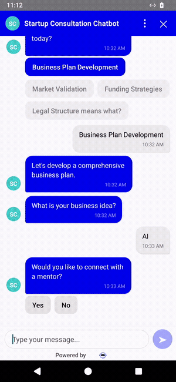
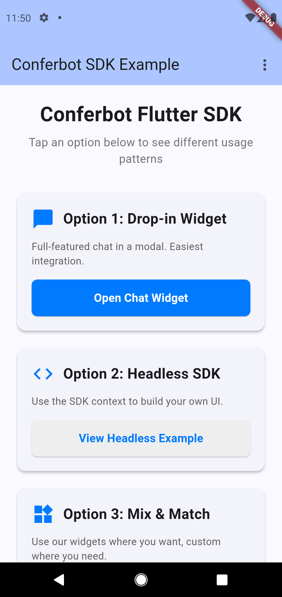
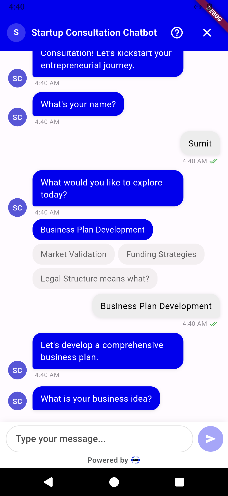

# Conferbot Flutter SDK

[](https://pub.dev/packages/conferbot_flutter)
[](https://flutter.dev)
[](https://dart.dev)
[](LICENSE)

Native Flutter SDK for embedding Conferbot AI chatbots into iOS and Android applications.

## See it in action

The complete flow recorded live on an Android emulator against production: open the widget, bot loads with the flow builder's theme, name question, choice selection, and the next flow node - end to end.

<p align="center">
  
</p>

<p align="center"><a href="docs/demo.mp4">HD video (MP4)</a></p>

<p align="center">
  
  
  
</p>

---

## Table of Contents

- [Installation](#installation)
- [Quick Start](#quick-start)
- [Floating Bubble (FAB)](#floating-bubble-fab)
- [Passing User Identity](#passing-user-identity)
- [Theming and Flow-Builder Customizations](#theming-and-flow-builder-customizations)
- [Advanced](#advanced)
- [API Reference](#api-reference)
- [Troubleshooting](#troubleshooting)
- [Example App](#example-app)

## Installation

Add the package to your `pubspec.yaml` (package name `conferbot_flutter`, current version `1.0.0`):

```yaml
dependencies:
  conferbot_flutter: ^1.0.0
```

Then fetch dependencies:

```bash
flutter pub get
```

Requirements: Flutter `>=3.10.0`, Dart SDK `>=3.0.0 <4.0.0`.

If you use session persistence (on by default), initialize Hive storage once before `runApp`:

```dart
void main() async {
  WidgetsFlutterBinding.ensureInitialized();
  await StorageService.init(); // required for session persistence
  runApp(const MyApp());
}
```

### Credentials

You need a **bot ID** (and optionally an API key) from the [Conferbot dashboard](https://app.conferbot.com):

1. Log in and create or select a bot.
2. Publish the bot (unpublished bots do not serve a flow).
3. Copy the bot ID from the bot's settings or from the embed snippet.

No account yet? The public demo bot `691c970890527a0468f9b2c9` works without one - it is the same bot the example app ships with.

## Quick Start

The smallest working integration: create one `ConferBotProvider` at the top of your tree, then push the drop-in `ChatWidget` whenever you want to show the chat.

```dart
import 'package:flutter/material.dart';
import 'package:provider/provider.dart';
import 'package:conferbot_flutter/conferbot_flutter.dart';

void main() async {
  WidgetsFlutterBinding.ensureInitialized();
  await StorageService.init();
  runApp(
    ChangeNotifierProvider(
      create: (_) => ConferBotProvider(
        apiKey: 'YOUR_API_KEY',
        botId: '691c970890527a0468f9b2c9', // demo bot, replace with yours
      ),
      child: const MyApp(),
    ),
  );
}

class MyApp extends StatelessWidget {
  const MyApp({super.key});

  @override
  Widget build(BuildContext context) {
    return const MaterialApp(home: HomeScreen());
  }
}

class HomeScreen extends StatelessWidget {
  const HomeScreen({super.key});

  @override
  Widget build(BuildContext context) {
    return Scaffold(
      appBar: AppBar(title: const Text('My App')),
      floatingActionButton: FloatingActionButton(
        child: const Icon(Icons.chat),
        onPressed: () {
          Navigator.push(
            context,
            MaterialPageRoute(
              builder: (_) => ChangeNotifierProvider.value(
                value: context.read<ConferBotProvider>(),
                child: const ChatWidget(
                  title: 'Support Chat',
                  placeholder: 'Type your message...',
                ),
              ),
            ),
          );
        },
      ),
    );
  }
}
```

`ChatWidget` is the complete chat UI: header with bot name and avatar, message list with pagination, every flow node type the web widget runs, offline banner, live agent handover, knowledge base, and the input bar. It calls `openChat()` on the provider automatically when it appears.

## Floating Bubble (FAB)

For web-widget parity - a chat bubble floating at the bottom-right of your app that opens the chat in a bottom sheet - wrap your app content in `ConferBotFAB`. The real constructor:

```dart
const ConferBotFAB({
  super.key,
  required this.child,          // Widget: your app content
  this.config = const ConferBotFABConfig(),
  this.theme,                   // ConferBotTheme? forwarded to ChatWidget
});
```

`ConferBotFAB` must sit below a `ConferBotProvider` in the tree:

```dart
class MyApp extends StatelessWidget {
  const MyApp({super.key});

  @override
  Widget build(BuildContext context) {
    return MaterialApp(
      home: ChangeNotifierProvider(
        create: (_) => ConferBotProvider(
          apiKey: 'YOUR_API_KEY',
          botId: 'YOUR_BOT_ID',
        ),
        child: ConferBotFAB(
          child: Scaffold(
            appBar: AppBar(title: const Text('My App')),
            body: const Center(child: Text('Your app content')),
          ),
        ),
      ),
    );
  }
}
```

Or use the one-liner convenience wrapper `ConferBotFABScope`, which creates the provider for you:

```dart
ConferBotFABScope(
  apiKey: 'YOUR_API_KEY',
  botId: 'YOUR_BOT_ID',
  child: MaterialApp(home: MyHomePage()),
)
```

Full `ConferBotFABScope` parameters: `apiKey`, `botId`, `child` (required), plus optional `fabConfig` (`ConferBotFABConfig`), `providerConfig` (`ConferBotConfig`), `customization` (`ConferBotCustomization?`), `user` (`ConferBotUser?`), `baseUrl`, `socketUrl`.

### What the launcher draws

Once the bot's settings arrive, the launcher is drawn as the web widget draws it on a phone: colour or left-to-right gradient, icon ink that stays readable on light colours, launcher icon or uploaded image, left/right position, the phone size and offsets (`mobileWidgetSize`, `mobileOffsetBottom`, `mobileOffsetSide`; else 16 from the edges), shape (`launcherShape`: speech bubble by default, circle, squircle, tab, peek), style (`launcherStyle`: icon, the bot's avatar with an online dot, the label pill on tablets (phones show the round button, as the web does), or your mascot, below; an uploaded image always wins), a soft glow in the header colour, and the greeting card (see below). All 56 dashboard launcher icons are drawn as on the web, and they move as on the web: an idle moment about 2s after the launcher shows and a few more after (`launcherAnimation` subtle / lively; off stops it), a reaction when a message arrives while the chat is closed, and the ripple rings. Nothing moves while the chat is open, after it was opened, or with the phone's animations turned off.

**Your mascot.** The mascot you design in the dashboard: one of 27 characters (`mascotShape`) with its eyes (`mascotEyes`), accessory (`mascotAccessory`), colour (`mascotColor`, else the launcher's) and name (`mascotName`).

- The `mascot` launcher style shows its head over a soft light button at `mascotLauncherScale`% of the button (70-150, 112 by default), blinking now and then, and hopping with a big smile when a reply arrives while the chat is closed. Open, the button is the brand colour with its cross.
- `mascotInGreeting` puts it on the greeting card in place of the avatar, by its name, waving twice.
- `mascotMotion` sets how the greeting card and its figure (the mascot or the avatar) move: lively (the default: the card springs up, the figure pops in, waves and nods, the Online dot pings once, the words fade up, then a slow breath and at most three small gestures before it stands still), subtle (a rise, the ping and one tilt) or off. Opened from the card, the figure hands off toward the launcher as the card collapses; the card's x makes it bow as the card fades. A voice-note card makes it talk while the waveform plays. No gestures while the app is in the background.
- The idle call (below) sends your mascot out, about its own joints.
- With the phone's animations off it stands still (a happy one keeps its smile). Glows and the bevel are not drawn.

Three more effects are opt-in from the dashboard, all off by default, as on the web:

- **Entrance** (`launcherEntrance`): classic (it just appears) or lightning, rocket, portal, ufo, drop, confetti, coin, meteor, magic, parachute, plane, egg. It plays once per app session per bot, never over an open chat. The launcher is hidden until the effect reveals it (a tap still opens the chat and ends it); the greeting card stays hidden until the launcher has landed, then fades up 150 ms later.
- **Attention** (`launcherAttention`): off, pulse, wobble, bounce, wave, float, shine, heartbeat, orbit. The first beat comes 1.5s after the launcher (or, for wave and float, the greeting card) shows, then one beat per lap. It pauses while the launcher plays an idle or message moment and stops for the session once the chat is opened. While it moves the launcher, the idle moments and the three load ripples give way to it.
- **Idle call** (`launcherIdleCall`, `launcherIdleCallDelay` 5-120s, default 12; `launcherIdleCallText`, 24 characters): off, psst, peek, wave, knock, tap. If the chat has not been opened, your mascot slips out from behind the launcher and calls the visitor; its speech bubble opens the chat. At most twice per app session, 3 minutes apart, then 3 days of rest (also after the chat is opened); closing the greeting stops calls for the session. It waits while the chat is open, the app is in the background, the keyboard is up, an entrance is landing, or the greeting has been up less than 15s. With the greeting up there is no bubble.

None of them plays with the phone's animations turned off. Glows, blurs and other web filters are not drawn.

### Local fallback config

`ConferBotFABConfig` holds compile-time fallbacks. Server values from the dashboard always take precedence when present:

```dart
const ConferBotFABConfig({
  this.size = 50.0,                     // bubble diameter in dp
  this.position = FabPosition.right,    // FabPosition.left or .right
  this.offsetX = 10.0,                  // horizontal offset from screen edge
  this.offsetBottom = 10.0,             // offset from screen bottom
});
```

### What the bubble does

- Tapping opens the chat in a `showModalBottomSheet` (draggable, 92% of screen height); the icon morphs to a close (X) while open.
- Shows a red unread-count badge when messages arrive while the chat is closed.
- Shows the web widget's greeting card above the bubble when the greeting is on (`chatIconCta` + `chatIconCtaText`, or greeting rules), after `greetingDelay` seconds (default 3), in the dashboard's `greetingStyle`: card, note, imessage (default), postcard, sticky, typewriter, glass, notification, neon, voice or aurora, each with its web reveal. Greeting rules work as on the web, with the app counted as the home page ("/"): audience (new/returning, signed in = the provider `user` has an id or email), schedule, visits, chatted, per-rule limits and priority. Rules for given pages, countries, sources or page attributes never apply. `greetingFrequency` is honoured: every launch with a 5-minute rest after a close, once per app session, or once every N days. Tapping the card opens the chat (or sends the message, or opens the rule's link); a starter chip opens the chat and sends that text; the X dismisses it. What it has seen is kept per bot in `shared_preferences` under `conferbot.greeting.<botId>`. The card uses the platform's nearest fonts (Noteworthy / Marker Felt / Georgia / Courier New on iOS; casual / serif / monospace on Android). No fonts are bundled.
- Renders the same bubble icon set as the web widget (`WidgetBubbleIcon1` through `WidgetBubbleIcon15`), painted natively from the dashboard's `widgetIconSVG` setting.

### Server-driven bubble appearance

These flow-builder settings are read live from the server and override `ConferBotFABConfig`:

| Dashboard setting | Effect |
|---|---|
| `widgetIconBgColor` (fallback `headerBgColor`) | Bubble color (default `#1B55F3`) |
| `widgetSize` | Bubble diameter |
| `widgetPosition` | `left` or right side |
| `widgetOffsetLeft` / `widgetOffsetRight` / `widgetOffsetBottom` | Edge offsets |
| `widgetBorderRadius` | Bubble corner radius (default: circle) |
| `widgetIconSVG` | Which bubble icon to draw |
| `chatIconCta`, `chatIconCtaText`, `greetingRules`, `greetingDelay`, `greetingClickAction`, `greetingFrequency`, `greetingFrequencyDays`, `greetingStyle` | Greeting card above the bubble |
| `launcherStyle: mascot`, `mascotShape`, `mascotEyes`, `mascotAccessory`, `mascotColor`, `mascotName`, `mascotLauncherScale`, `mascotInGreeting`, `mascotMotion` | Your mascot: in the launcher, on the greeting card, in the idle call and the typing bubble |

## Passing User Identity

Identify the visitor by passing a `ConferBotUser` to the provider (or to `ConferBotFABScope`):

```dart
ConferBotProvider(
  apiKey: 'YOUR_API_KEY',
  botId: 'YOUR_BOT_ID',
  user: const ConferBotUser(
    id: 'user-42',                 // required
    name: 'Jane Doe',
    email: 'jane@example.com',
    phone: '+15551234567',
    metadata: {'plan': 'pro'},
  ),
)
```

The model (from `lib/src/models/user.dart`):

```dart
const ConferBotUser({
  required this.id,
  this.name,
  this.email,
  this.phone,
  this.metadata,
  this.hash,
});
```

How it is used: when a chat session starts, the SDK calls `POST /session/init` with `userId: user.id` (falling back to the auto-generated visitor ID), so conversations are attributed to your user across sessions. The whole user (its `metadata`, then `id`, `name`, `email`, `phone`) also travels with every message record as the chat's visitor context, as the web widget's `visitorContext` does, so the dashboard shows the visitor's name, email and your own fields.

### Identity verification

To stop anyone posing as one of your users, turn on identity verification in your workspace and pass a `hash`: the HMAC-SHA256 (hex) of the user's `id` (or `email` when there is no id), keyed with your workspace's identity secret. Make it on your server and never ship the secret in the app.

```dart
ConferBotUser(id: 'user-42', email: 'jane@example.com', hash: hashFromYourServer)
```

The server checks the hash and drops it before storing. A chat with a matching hash is filed as verified; a wrong hash is rejected, and no hash leaves it unverified.

If no user is passed, the SDK generates a persistent anonymous visitor ID (stored via Hive) and reuses it across app restarts.

### Signing in or out later

When someone signs in (or out) after the chat is up, tell the provider, as `identify(user:)` on iOS and `Conferbot.identify` on Android:

```dart
context.read<ConferBotProvider>().identify(
  ConferBotUser(id: 'user-42', email: 'jane@example.com', hash: hashFromYourServer),
);

// Signed out:
context.read<ConferBotProvider>().identify(null);
```

From then on the message records carry the new user (with its `hash`), "Your requests" is read again for them (a signed-out user's list is dropped), greeting rules that ask whether the visitor is signed in decide again, and the owner's "Greet by name" texts are filled again for them ([Greet by name](#greet-by-name)). With no stored visitor ID, the user's id goes with the next socket handshake and session. A conversation already going keeps its session.

## Theming and Flow-Builder Customizations

### Server customizations apply automatically

When the widget connects, the server sends the bot's flow-builder customizations (the same ones the web widget uses): header colors, bubble colors, chat background, bot name, bot avatar, font size, and bubble border radius. The SDK builds a theme from them via `ConferBotProvider.serverTheme` and applies it with no code on your side.

- **Chat background**: solid, gradient (linear, radial, mesh, blur), image with its mask, or one of the 13 patterns.
- **Widget theme**: all 27 dashboard themes (Classic, Minimal, Glass, Neo-brutal, Midnight, Aurora and the rest). Each brings its surfaces, text colours, corner radii and bubble outline, as on the web widget. **Appearance** light, dark, or auto (follows the phone's dark mode, also when it changes while the chat is open); Midnight, Neon, Chalkboard, Cyberpunk and Space are always dark. **Colours** "Brand" keeps your colours; "Theme palette" swaps in the theme's own header, bubble, option, launcher and send-button colours (`serverCustomizations` then carries them). Your own bubble radius, option radius and chat background still win over the theme. Theme fonts are not loaded; the app's font is used. `ConferBotProvider.widgetTheme` exposes the theme in force.

Keys consumed from the dashboard: `headerBgColor`, `headerTextColor`, `botMsgColor`, `botTextColor`, `userMsgColor`, `userTextColor`, `optionBubbleMsgColor`, `optionBubbleTextColor`, `chatBgColor`, `fontSize`, `bubbleBorderRadius`, plus `botName` / `logoText` (header title) and `avatar` / `logo` (header and message avatar).

### Precedence: server settings override local theme

This is exact, from `ChatWidget.build`:

```dart
final effectiveTheme = provider.serverCustomizations != null
    ? provider.serverTheme
    : (widget.theme ?? defaultTheme);
```

So:

1. If the server sent customizations, **`serverTheme` is used and your local `theme:` is ignored** for the chat UI. `serverTheme` itself is `defaultTheme` with the dashboard values merged over it, and any color the dashboard omits falls back to the web widget defaults (`#1B55F3` bubbles, white text).
2. If the server sent nothing (for example, offline before first fetch), your local `theme:` applies.
3. Otherwise `defaultTheme` (light) applies.

The FAB follows the same rule: server bubble settings win over `ConferBotFABConfig`.

If you want your own branding to win, do not set colors in the bot's flow-builder appearance settings; leave them at defaults and pass a local theme.

### Local themes

```dart
// Built-ins
ChatWidget(theme: defaultTheme); // light
ChatWidget(theme: darkTheme);    // dark

// Custom: start from a built-in and override
final brandTheme = defaultTheme.copyWith(
  colors: defaultTheme.colors.copyWith(
    primary: const Color(0xFF6366F1),
    headerBg: const Color(0xFF6366F1),
    userBubble: const Color(0xFF6366F1),
    botBubble: const Color(0xFFF3F4F6),
  ),
  borderRadius: const ConferBotBorderRadius(bubble: 20.0),
);

ChatWidget(theme: brandTheme);
```

`ConferBotTheme` is composed of `ConferBotColors`, `ConferBotTypography`, `ConferBotSpacing`, `ConferBotBorderRadius`, `ConferBotShadows`, `ConferBotAnimations`, and `ConferBotLayout`, all with `copyWith`-friendly construction (colors have a full `copyWith`; the others are const-constructible with named defaults).

Note: the provider also accepts a `ConferBotCustomization` object (`primaryColor`, `fontFamily`, `bubbleRadius`, `headerTitle`, `enableAvatar`, `avatarUrl`, `botBubbleColor`, `userBubbleColor`). It is currently stored but not applied to rendering in this version - use `ConferBotTheme` for local styling instead.

### Widget languages

The SDK draws its own words in English, Dutch, French, German or Spanish, with the web widget's wording:

1. `ConferBotConfig(widgetLanguage: 'de')`, when the app sets it ("en", "nl", "fr", "de", "es" or "auto").
2. Otherwise the language the owner picked in the dashboard (`widgetLanguage`).
3. "Auto" (and every bot that never chose): the first of the phone's languages the widget speaks (`PlatformDispatcher.locales`, most preferred first).
4. Otherwise English.

What the owner wrote (greetings, questions, buttons, articles) is shown as written; the stock English texts a new bot starts with ("We're here to help", "Hi there 👋") are shown in the visitor's language. Dates, times, day and month names and "5 min ago" follow the language too, keeping the phone's region when it speaks the same language ("nl-BE"). `I18n.language` says which one is in force (`I18n.languageListenable` to listen), and the provider tells its listeners when it changes. The words come from the table all Conferbot SDKs share: `sh tool/sync_i18n.sh` rebuilds `lib/src/core/i18n/` from the React Native SDK's `scripts/parity/i18n/strings.json` (`--check` says whether it is up to date).

## Advanced

### Headless usage (custom UI)

`ConferBotProvider` is a `ChangeNotifier` and the whole SDK works without any of the bundled widgets:

```dart
final provider = context.watch<ConferBotProvider>();

// State
final messages = provider.record;            // List<RecordItem>
final connected = provider.isConnected;
final agent = provider.currentAgent;         // Agent? during live handover
final uiState = provider.currentUIState;     // current interactive node state
final done = provider.isFlowComplete;

// Actions
await provider.openChat();                   // start or resume the session
await provider.sendMessage('Hello!');        // free-text answer / live chat message
provider.submitResponse(choiceValue);        // answer the current interactive node
provider.initiateHandover(message: 'I need a human');
provider.sendTypingStatus(true);
provider.resetConversation();
```

For interactive nodes you can either build your own UI from `currentUIState` (typed states like `SingleChoiceUIState`, `RatingUIState`, `CalendarUIState`, `CarouselUIState`, `SliderUIState`, `MatrixUIState`, ...) or reuse the SDK's `NodeRenderer`. Answer with `submitResponse` in the shape the step reads (see "How bot flows run"). Individual building blocks are also exported: `ChatHeader`, `MessageList`, `SimpleMessageList`, `MessageBubble`, `ChatInput`, `ChatBottomBar`, `TypingIndicator`, `ConnectionStatus`, `OfflineIndicator`, `Avatar`, `EmptyState`.

### How bot flows run

The flow engine (`NodeFlowEngine`, driven by the provider) runs a bot the way the web widget does. It is tested against the shared flow-node spec: 156 cases whose outcomes come from running the web widget's own code (`test/parity/flows_test.dart`, all passing).

- The chat starts at the first welcome step. A step that doesn't branch leaves by its first edge. A branch (a choice, a condition, an AI route) leaves by its exact handle; when that handle has no edge, the chat ends. An unknown step shows nothing and continues along its first edge.
- The steps read the fields the builder saves. A question saves its answer only when it has an answer variable. Logic and integration results are saved by name.
- Bot text fills `{x}`, `${x}`, `{{x}}`, `${ANSWERS.x}` and `$${x}` from the answers. An unknown variable shows nothing.
- The typing bubble follows `typingStyle`: dots, wave, shimmer, a pencil writing a line, or your mascot swaying by three thought dots ("Pip is typing" for screen readers when you named it).
- Typing dots before each step last as long as the web's (by the length of what is said). An image or video moves on once it loads, or after 4 seconds at most.
- Card numbers, bank accounts, government ids and passwords are masked in the answers and in the record the server gets, unless the bot's `redactSensitive` is off. What the visitor typed stays in their own chat.
- GPT, AI route, AI extract, knowledge-base answers, OTP, address search and payments go through the bot's server (`/api/v1/bot/:botId/...`). No API key is ever on the device.
- Payment, OTP and consent steps are gates: typed text does not get past them.

Each step says its own lines: the question, a greeting, an answer, a picture, a video, a file, HTML or a link. They reach the chat through `flowEngine.botMessageStream`, and the visitor's answers through `userMessageStream`. The step waiting for the visitor is `currentUIState`. Answer it with `submitResponse`:

| Step | Answer |
|---|---|
| Typed questions (name, email, phone, number, URL, OTP code, AI and knowledge-base questions, typed signature) | the text, as a `String` |
| Buttons, dropdown, image choice, yes/no, legacy choices | `{'buttonId': id}` |
| Check options | `{'buttonIds': [ids]}` |
| Rating, opinion scale, slider, date/time | `{'value': v}` |
| Calendar | `{'date': 'YYYY-MM-DD', 'slot': 'HH:MM'}` |
| File | `{'file': {name, size, type, uri}}`, or `{'skip': true}` |
| Carousel, product card | `{'buttonId': id, 'cardId': id}`, or `{'action': 'continue'}` |
| Consent | `{'agreed': true}` |
| Ranking | `{'order': [ids]}` |
| Matrix | `{'cells': {rowId: colId}}` (a list of column ids for a multiple-choice matrix) |
| Address | `{'action': 'search', 'q': text}`, `{'action': 'pick', 'index': i}`, or `{'action': 'manual', 'line1': ..., 'city': ..., 'region': ..., 'postal': ..., 'country': ...}` |
| Payment | `{'action': 'open'}` (Pay now), `{'action': 'check'}`, `{'action': 'cancel'}` |
| Navigate | `{'buttonId': 'link-<i>'}` to open a link, `{'action': 'done'}` |
| OTP | an email or a code as text, or `{'action': 'skip'}` |

`NodeRenderer` sends all of these for you, with a card for each step as the web draws it: the signature pad (or the name typed), the OTP e-mail and six digit boxes with Resend and Change email, the address search with suggestions and a map to confirm, consent with its links, the date and time pickers, the calendar's month and free times, the payment card, carousels, slider, ranking, matrix and image choice. The cards use the bot's option colours, option corner radius and font size. Pass `stepKey: provider.stepVisit` and `error: provider.stepError` so a card keeps what was entered and shows why an answer was refused, as `ChatWidget` does.

A drawn signature is sent as `{'action': 'sign', 'method': 'drawn', 'dataUrl': 'data:image/png;base64,...', 'width': w, 'height': h}` (add `'fullName'` when the step asks for it); a typed one as `{'action': 'sign', 'method': 'typed', 'name': name}`. OTP also takes `{'action': 'send', 'email': e}`, `{'action': 'verify', 'code': c}` and `{'action': 'resend'}`.

### Socket events

Subscribe to the raw real-time events:

```dart
provider.on(SocketEvents.botResponse, (data) { /* bot node arrived */ });
provider.on(SocketEvents.agentAccepted, (data) { /* human joined */ });
provider.on(SocketEvents.agentMessage, (data) { /* agent message */ });
provider.on(SocketEvents.agentTypingStatus, (data) { /* typing */ });
provider.on(SocketEvents.chatEnded, (data) { /* chat closed */ });

provider.off(SocketEvents.botResponse);      // unsubscribe
provider.emit('custom-event', {'k': 'v'});   // raw emit
```

### Offline behavior

Built in and on by default (`ConferBotConfig.enableOfflineMode`):

- `ConnectivityService` watches network state (connectivity_plus).
- Outgoing messages sent while offline are queued by `MessageQueueService` and retried automatically when connectivity returns; `ChatWidget` shows an offline banner (`OfflineIndicator`) with pending count and a retry-all action, and the input placeholder switches to "Offline - messages will be queued".
- `ChatWidget(showOfflineIndicator: ..., showDeliveryStatus: ...)` control the UI parts.

### Session persistence

On by default (`enablePersistence: true`). Sessions are stored in Hive and restored on restart within the `sessionTimeout` (default 30 minutes, matching the web widget). Requires `await StorageService.init()` before `runApp`. Related APIs: `provider.sessionRestored`, `provider.persistState()`, `provider.clearCurrentSession()`, `provider.clearAllPersistedData()`, `provider.getStorageStats()`.

A restored session resumes at the step it was on; the flow is not run again from the top, and not again on a reconnect. `openChat()` waits for start-up, so opening the chat straight away still gets the restored session. A live chat comes back live: the SDK asks the server (`live-chat-state`) and picks up the person on the chat, the wait for one (without asking for a person a second time), or carries the flow on when the chat ended while the app was closed.

### Handover lifecycle

As on the web widget:

- When an AI agent hands the visitor to the team, the conversation shows "Connecting you with the team…" with typing dots. The line settles to how the wait ended: "Connected with the team", "The team couldn't join just now", "You left the queue" or "Chat ended before the team joined". An AI pausing an idle visitor draws nothing.
- A person joining draws "<name> joined the chat" (with "They can see your conversation so far" after an AI handover), once per person.
- The header keeps the bot's name. Under it: the team's reply time ("Typically replies in a few minutes", "Online · team back Monday 9 AM", "Online · team replies by email"), or plain "Online" once a person is in the chat. `provider.headerStatus` gives the same words.
- The handover step's wait card has **Leave queue** (`provider.leaveQueue()`). It sends `queue-self-resolve`, so the team stops seeing the visitor waiting, and the flow carries on. It returns `false` when a person has already picked the chat up; the visitor then stays.
- An AI agent bot offers "Talk to a person" (when the owner turned it on) only while no handover is under way and nobody is here; it goes once tapped.
- The handover request carries the step's settings: `enableHandoverEmail` (false keeps the team's email off), the sound settings, and `assignmentMethod` / `requiredSkills`.
- When the agent leaves and the chat goes back to the queue (`live-chat-requeued`), "Connecting you to another agent..." (or "Connecting you to Sales..." after a team transfer) is drawn, and a flow at its handover step waits again. A transfer (`live-chat-transferred`) is kept in the conversation's record, not drawn.
- The same end twice (an agent's double click) draws one "Chat has ended" line and one survey; each end has its own record id. Once the chat has ended and nothing is going on, the composer turns off and **Start a new chat** (`provider.startNewChat()`) starts a fresh conversation.
- A visitor the workspace blocked sees "This conversation has been closed." (mid-chat, or at connect: the visitor id goes with the socket handshake) and can't type or start a new chat. `provider.visitorBlocked` and `provider.closedState` say so.
- When the live chat ends, the handover step's post-chat survey questions are asked if the builder turned on `enablePostChatSurveyQuestions`.

### AI answers

As on the web widget:

- Replies draw tables (they scroll sideways), headings (`#` and `##` as level 4, `###` a little larger), quotes, code blocks and strikethrough, from an AI's markdown or a person's HTML.
- **Helpful?** under the newest AI answer: a No is sent at once (`ai-answer-feedback`), then the reasons, an optional comment, "Talk to a person" (only while nobody is coming or here) and "Ask another way" (the cursor goes to the composer). The rated line's thumbs change the vote; the vote is kept on the answer's record entry. The owner's `hideAnswerFeedback` turns it off.
- When the AI has not answered after 45 seconds, the dots give way to "That took too long. Try again, or ask for a human." A reply the server sent because the AI failed (`isFallback`) is italic at 85%.
- Every response record carries the phone's preferred language as `visitorInsights.language.browser` (BCP 47, e.g. "de-DE"), so the AI answers short messages in it.

### Email me this chat

The chat menu (the header's ⋮) has **Email me this chat**. One card asks for the address (filled in when the visitor gave one), the server sends the whole conversation there (`POST {apiBaseUrl}/chat/transcript-email` with `{chatSessionId, email}`; the bot is the `X-Bot-ID` header's), and the card says "Sent! Check your inbox at ...". When it does not go, the server's own reason shows in English (for example its limit of 5 per 15 minutes); in the other languages the card says it could not be sent. Once sent, the address is kept as the visitor's. Headless: `provider.openEmailTranscript()`, `provider.emailTranscript(email)` (`TranscriptEmailResult {ok, message}`).

The web's waiting signals, for your own UI (for example a "we'll email you" prompt):

```dart
final stop = provider.onWidgetSignal(WidgetSignals.waitingForHuman, (detail) {
  // detail: {offline, reason: 'offline' | 'busy', backAt, emailCaptured}
});
provider.onWidgetSignal(WidgetSignals.humanJoined, (detail) {});   // {name}
provider.onWidgetSignal(WidgetSignals.waitOver, (detail) {});      // {reason: unavailable | cancelled | ended}
stop(); // stop listening
```

`cb:waiting-for-human` fires from the server's `handover-waiting`, or 20 seconds into a wait for a person with nobody yet (once per wait, and only while the chat is open). No signal carries the visitor's email.

### While you wait

As on the web widget, while the visitor waits for a person (a flow's handover step with no AI agent on it, an AI handing the chat to the team, or a restored chat still in the queue):

- **Help articles.** 6 seconds into the wait, "While you wait, this might help" shows up to two help-centre articles that match the visitor's last real question (only while the owner's help centre is on). When the server picks the help itself (`queue-help`, or a waiting `queue-status` with `help`), its pick replaces ours and has **That solved it**: it sends `queue-self-resolve {chatSessionId, articleId}`, and if the server agrees the visitor leaves the queue ("You left the queue. Glad that helped.", recorded as "Resolved while waiting"). An article opens in the app's help centre view; one the help centre does not list is fetched from the server by its id. A page opens in the browser. Once the wait is over the card stays as "Articles that might help".
- **Games.** 2.5 seconds after the waiting signal (`cb:waiting-for-human`), a card offers seven games: rock paper scissors, tic-tac-toe, a quick quiz (with questions from the bot's help centre when it has enough), memory match, a reflex test, emoji riddles and word scramble, with the web's rules and scoring. The owner's `waitingGames` setting (`{enabled, games, offerText}`) picks them; unset is on with all seven. **Not now** or the x stops the offers for the app session. Typing "play" or "games" while waiting opens the menu instead of sending the words. When a person joins, an unused offer goes and a game in progress is saved ("Sam's here!", **Finish my game**).
- The composer stays open during the wait: what the visitor types goes as a live message for whoever joins.
- The cards follow the phone's reduced-motion setting, and are drawn in the conversation only: never saved on the device or sent to the server.

Headless: `provider.waitHelpCard` (`HelpCardState`), `provider.openWaitHelpItem(item)`, `provider.solveWait()`, `provider.gamesCard` (`GamesCard`, its `state` and `subscribe`); `WaitHelpCard` and `GamesCardView` draw them.

### Your requests

As the web widget's "Your requests": the visitor's own conversations with your team, where each one stands in plain words ("We replied", "We're on it", "Solved"), and a reply box that reaches the team. A reply to a solved one opens it again.

- **Where:** on the [home screen](#home-screen) (up to two, "See all (n)", above "Talk to us" when a reply is new) and in the chat menu (the header's ⋮): **Your requests** once the visitor has one, **Your requests · New reply** when a team reply has not been read on this device. It opens over the home screen or the chat: the list (new replies first, "New reply from Ada · 2 hours ago"), then one request with a banner, the conversation (links tappable) and the reply box (Sending..., Not sent with Try again, or "This conversation is closed for replies."). Back and Android's back go one step back. Team replies show up live while a request is open.
- **Whose they are:** only the visitor's own. The device remembers, per bot, the last 30 chats the visitor wrote in and when each request was last read (shared_preferences), and the server lists a conversation only when its id is one of those and its visitor id matches. A signed-in user (`ConferBotUser` with a valid `hash`, see [Identity verification](#identity-verification)) also sees their verified conversations on this bot from any device, read again when they sign in or out with `identify`. Only conversations a person on the team handles are requests; a chat the AI answered alone is not one. Nothing is asked for a first-time visitor.
- **Look:** the theme's page, card and text colours, one accent (the bot's brand colour, else its header or launcher colour, else indigo), and the app's `ConferBotCustomization.fontFamily`. It slides in once (not with animations turned off).

Headless: `provider.myRequests` (`List<RequestSummary>?`), `provider.requestsUnread` (for your own badge), `provider.openRequests([requestId])`, `provider.closeRequests()`, `provider.requestsOpen`; `provider.requests.portal` (`RequestsPortal`, a `ChangeNotifier` with `state` and the actions) is drawn by `RequestsPortalView`.

```dart
Badge(
  isLabelVisible: provider.requestsUnread > 0,
  label: Text('${provider.requestsUnread}'),
  child: IconButton(icon: const Icon(Icons.inbox_outlined), onPressed: () => provider.openRequests()),
)
```

### Home screen

When the owner turns on the home screen (Customize > Home, `enableInitialPage`), the chat opens on it, as the web widget does; with it off the chat opens straight on the conversation. It follows the owner's settings:

- **Header:** "Good morning" / "Good afternoon" / "Good evening" by the phone's clock, or "Welcome back, Jamie" when the visitor has written before (the device remembers their first name and the first real question of their latest conversation for 60 days, per bot, in shared_preferences). The bot's logo and name (none with `hideLogo`), the owner's title (`initialPageTitle`) and description (`initialPageDescription`; an early bot's placeholder copy becomes "Ask us anything - we're here to help."), on a band in the launcher's colours.
- **Ask anything** (`homeAskBox`, on unless off; only with an AI agent or a published article): for an AI agent, "Ask “...”" opens the conversation and asks it; the help articles that answer it (the server's search inside article text too); for a flow bot with nothing found, "Chat with us".
- **Pick up where you left off** (AI agent bots): opens the conversation still on the device, else asks the remembered question again.
- **Your requests:** two rows and "See all (n)"; above "Talk to us" when a team reply is new. Opens the requests portal over the home.
- **Talk to us:** the card's face (`initialPageAvatar`, else the bot's avatar or logo), "Online" with a green dot (none with `hideOnlineStatus`) and the reply time ("Usually replies in a few minutes", "Team back tomorrow 9 AM", "Answers instantly, day or night"; `replyTime`), the team's photos (`homeTeamPhotos`, up to 3), the button (`initialPageCardButtonText`, else "Chat with us"), up to 3 of an AI agent's questions, the rating (`homeRating`).
- **Help card** (`enableKnowledgeBase` with a published article): Recent articles (not with `hideRecentArticles`), the topics, See all; its own search when the ask box is off. Articles and topics open the help centre; its Back returns to the home.
- **Customer logos** (`homeTrustLogos`, https only, with `homeTrustLabel`), shown once one has loaded.
- **Moving between views:** the chat header's ‹ and Android's back go from the conversation to the home; the home's cross closes the chat. A greeting card's "send" (and its questions) go past the home to the conversation. The views switch in the owner's `viewTransition` / `viewTransitionDirection`: fade, slide, and every other kind as a slide; classic and none at once; a 200ms fade with the phone's animations off.

Calm and in the bot's look: the widget theme's page, cards and text (light or dark), one accent, the app's `ConferBotCustomization.fontFamily`. Each part rises into place once, never with animations off. Not in apps: the web's page-aware parts ("For this page" articles), which need a web page.

The web's home has no mascot. To put yours on the home, or anywhere in your app (moods: idle, wave, think, happy):

```dart
ChatWidget(homeMascotBuilder: (context, m) => Mascot(look: m.look, accent: m.accent, size: 56, mood: 'wave'));
Mascot(look: provider.customizations.mascot, accent: provider.customizations.mascotAccent, mood: 'think');
```

Headless: `provider.homeModel` (`HomeModel?`, everything the screen draws, null without a home), `provider.homePalette`, and `provider.home` (`HomeExtras`): `view`, `chosen` (a `ValueNotifier<HomeView?>`), `showHome()`, `showChat([text])`, `showHelp({categoryId})`, `back()`, `memory`, `searchArticleText(query)`. `HomeScreenView` and `ViewSwitch` are exported for your own chat screen.

```dart
// Open the chat on the conversation and ask a question there.
provider.home.showChat('Where is my order?');
```

### Greet by name

The owner's texts may greet the visitor by name: `{{first_name|there}}`, `{{name}}`, `{{company|your team}}` (the part after the bar is the fallback). The SDK fills them from the signed-in user (`ConferBotUser.name`, or `firstName` / `lastName` / `company` in its `metadata`) and a name the chat asked for, before anything reads the settings: the greeting card, the launcher's call-to-action and the home screen's title, description and button all show "Hi Sam", or "Hi there" when the name is not known. `identify` fills them again.

### Push token registration

Register a device token (FCM, APNs, or any provider) against the current chat session:

```dart
await provider.registerPushToken(deviceToken);
```

Signature: `Future<void> registerPushToken(String token)` - it posts to `/push/register` with the session ID and platform. It is a no-op until a chat session exists (open the chat first). The SDK does not itself integrate Firebase; you obtain the token in your app.

### Knowledge base (help centre)

The help centre follows the owner's dashboard settings, as on the web widget:

- The help button shows in the `ChatWidget` header while **Help articles** (`enableKnowledgeBase`) is on and at least one article is published. With it off, or with no published article, there is no button.
- **Recent articles** shows above the full list unless the owner hides it (`hideRecentArticles`).
- Article bodies are HTML and are drawn as such. The list comes with the bot's settings on connect (titles and descriptions only); an article's body is fetched when it is opened.
- When an AI answer cites a help centre article (a source or an article card with an `articleId`), tapping it opens that article in the help centre. Without a help centre on screen, a source with a public link opens the link.

`ChatWidget(showKnowledgeBase:)` overrides the owner's switch. The app's value wins:

| `showKnowledgeBase` | Help button |
|---|---|
| `null` (default) | follows `enableKnowledgeBase` and needs a published article |
| `false` | never |
| `true` | always, even with the owner's switch off (the screen then loads the articles over REST) |

You can also embed the help centre directly. It reads from the configured server (`ConferBotEndpoints` or `baseUrl`):

```dart
ChangeNotifierProvider(
  create: (_) => KnowledgeBaseProvider(
    apiKey: 'YOUR_API_KEY',
    botId: 'YOUR_BOT_ID',
  ),
  child: const KnowledgeBaseScreen(
    title: 'Help Center',
    showCategories: true,
    showSearch: true,
  ),
)
```

`KnowledgeBaseService` exposes the REST calls under `/mobile/knowledge-base`: `fetchHelpCentre` (categories with their articles, and the recent articles), `fetchCategories`, `fetchArticles`, `fetchArticle`, `searchArticles` (sends `query`), ratings and view tracking. `KnowledgeBaseProvider.openArticle(id)` opens an article by id. Articles can be inserted into the chat via `ChatWidget.onArticleInsert`.

### Analytics

On by default (`enableAnalytics: true`); events are batched and flushed every `analyticsFlushInterval` (default 30 s). Public hooks on the provider: `trackInteraction(type:, data:)`, `trackGoalCompletion(goalId:, conversionEvent:, conversionValue:)`, `submitChatRating(csatScore:, feedback:, thumbsUp:, npsScore:, source:)`, `trackTypingStart()`, `trackTypingEnd()`, `trackDeletion()`, `flushAnalytics()`, `getAnalyticsData()`.

### Custom endpoints and network tuning

By default the SDK talks to `https://wdt.conferbot.com` (REST base `https://wdt.conferbot.com/api/v1/mobile`). Override globally before creating the provider, or per provider:

```dart
// Global
ConferBotEndpoints.configure(
  apiBaseUrl: 'https://your-host/api/v1/mobile',
  socketUrl: 'https://your-host',
);
ConferBotNetworkConfig.configure(
  apiTimeout: const Duration(seconds: 15),
  reconnectionAttempts: 10,
);

// Per provider
ConferBotProvider(apiKey: '...', botId: '...', baseUrl: '...', socketUrl: '...');
```

### Voice messages and media

Voice recording/playback (`VoiceInputWidget`, `VoiceRecorder`, `VoicePlayer`, `VoiceMessage`) and media viewers (`ImageViewer`, `VideoPlayerWidget`, `AudioPlayerWidget`) are exported and used automatically by the relevant flow nodes. Markdown rendering with syntax-highlighted code blocks is built into bot messages (`MarkdownMessage`).

## API Reference

Signatures below are copied from source. Full generated docs: [docs/API.md](docs/API.md), [docs/COMPONENTS.md](docs/COMPONENTS.md).

### Entry points

| Class / member | Signature | Description |
|---|---|---|
| `ConferBotProvider` | `ConferBotProvider({required String apiKey, required String botId, ConferBotConfig config = const ConferBotConfig(), ConferBotCustomization? customization, ConferBotUser? user, String? baseUrl, String? socketUrl})` | Core state manager; connects socket and REST, runs the node flow engine |
| `ConferBotConfig` | `const ConferBotConfig({bool enableNotifications = true, bool enableOfflineMode = true, bool autoConnect = true, int? reconnectionAttempts, int? reconnectionDelay, bool enablePagination = true, PaginationConfig? paginationConfig, bool enableAnalytics = true, Duration analyticsFlushInterval = const Duration(seconds: 30), bool enablePersistence = true, Duration sessionTimeout = const Duration(minutes: 30)})` | SDK behavior switches |
| `ChatWidget` | `const ChatWidget({String? title, String? placeholder, bool showTimestamps = false, bool enableAttachments = false, ConferBotTheme? theme, bool enablePagination = true, MessageListPaginationConfig? paginationConfig, bool? showKnowledgeBase, ValueChanged<KnowledgeBaseArticle>? onArticleInsert, bool showOfflineIndicator = true, bool showDeliveryStatus = true, bool showHandoverPreChatForm = true, bool showHandoverPostChatSurvey = true, int handoverMaxWaitMinutes = 5, ValueChanged<SurveyResult>? onHandoverSurveySubmit})` | Drop-in full chat UI |
| `ConferBotFAB` | `const ConferBotFAB({required Widget child, ConferBotFABConfig config = const ConferBotFABConfig(), ConferBotTheme? theme})` | Floating chat bubble overlaying your app |
| `ConferBotFABConfig` | `const ConferBotFABConfig({double size = 50.0, FabPosition position = FabPosition.right, double offsetX = 10.0, double offsetBottom = 10.0})` | FAB fallbacks (server values win) |
| `ConferBotFABScope` | `const ConferBotFABScope({required String apiKey, required String botId, required Widget child, ConferBotFABConfig fabConfig = const ConferBotFABConfig(), ConferBotConfig providerConfig = const ConferBotConfig(), ConferBotCustomization? customization, ConferBotUser? user, String? baseUrl, String? socketUrl})` | Provider + FAB in one widget |
| `ConferBotUser` | `const ConferBotUser({required String id, String? name, String? email, String? phone, Map<String, dynamic>? metadata, String? hash})` | Visitor identity, sent as the visitor context |
| `StorageService.init` | `static Future<void> init()` | Initialize Hive persistence (call before `runApp`) |
| `ConferBotEndpoints.configure` | `static void configure({String? apiBaseUrl, String? socketUrl})` | Global endpoint override |
| `ConferBotNetworkConfig.configure` | `static void configure({Duration? apiTimeout, Duration? socketTimeout, int? reconnectionAttempts, Duration? reconnectionDelay, Duration? reconnectionDelayMax})` | Timeouts and retry policy |

### ConferBotProvider methods

| Method | Signature | Description |
|---|---|---|
| `openChat` | `Future<void> openChat()` | Start or resume a session and the flow |
| `closeChat` | `void closeChat()` | Mark chat closed, persist state |
| `sendMessage` | `Future<void> sendMessage(String text)` | Send free text (flow answer or live chat) |
| `submitResponse` | `void submitResponse(dynamic response)` | Answer the current interactive node |
| `initiateHandover` | `void initiateHandover({String? message})` | Request a live agent |
| `leaveQueue` | `Future<bool> leaveQueue()` | Leave the handover queue (`queue-self-resolve`); false when a person already has the chat |
| `onWidgetSignal` | `void Function() onWidgetSignal(String name, void Function(Map<String, dynamic>) listener)` | Listen to `WidgetSignals.waitingForHuman` / `humanJoined` / `waitOver`; returns a stop function |
| `talkToPerson` | `Future<void> talkToPerson()` | The quick action: asks the AI for a person and retires the button |
| `sendAnswerFeedback` | `void sendAnswerFeedback(String agentMessageId, AnswerFeedback feedback)` | Send a "Helpful?" vote (`AnswerFeedback(helpful, [reason, comment])`) and keep it on the answer |
| `openEmailTranscript` / `closeEmailTranscript` | `void openEmailTranscript()` / `void closeEmailTranscript()` | Show / hide the "Email me this chat" card |
| `emailTranscript` | `Future<TranscriptEmailResult> emailTranscript(String email)` | Email the transcript to this address; on success the address is kept as the visitor's |
| `identify` | `void identify(ConferBotUser? user)` | Sign a user in after construction, or out with `null` ([Signing in or out later](#signing-in-or-out-later)) |
| `openRequests` / `closeRequests` | `Future<void> openRequests([String? requestId])` / `void closeRequests()` | Open "Your requests" (the list, or one request) / leave it |
| `home.showHome` / `home.showChat` / `home.showHelp` | `void showHome()` / `void showChat([String? text])` / `void showHelp({String? categoryId})` | The open chat's view: the [home screen](#home-screen), the conversation (asking `text` there), the help centre |
| `startNewChat` | `Future<void> startNewChat()` | A fresh conversation after a chat ended (not for a blocked visitor) |
| `focusComposer` | `void focusComposer()` | Put the cursor in the chat's composer |
| `sendTypingStatus` | `void sendTypingStatus(bool isTyping)` | Visitor typing indicator |
| `sendLiveChatTyping` | `void sendLiveChatTyping(bool isTyping)` | Typing indicator during live chat only |
| `registerPushToken` | `Future<void> registerPushToken(String token)` | Register device push token |
| `on` / `off` / `emit` | `void on(String event, Function(dynamic) callback)` / `void off(String event, [Function(dynamic)? callback])` / `void emit(String event, [dynamic data])` | Raw socket events |
| `loadMoreMessages` | `Future<void> loadMoreMessages()` | Load older messages (pagination) |
| `refreshMessages` | `Future<void> refreshMessages()` | Reload messages from storage |
| `clearMessages` | `Future<void> clearMessages()` | Clear message list |
| `persistState` | `Future<void> persistState()` | Force-save session (e.g. on app pause) |
| `clearCurrentSession` | `Future<void> clearCurrentSession()` | Drop session, keep visitor ID |
| `clearAllPersistedData` | `Future<void> clearAllPersistedData()` | Wipe all stored sessions |
| `resetConversation` | `void resetConversation({bool clearPersistence = true})` | Restart the flow from scratch |
| `trackInteraction` | `void trackInteraction({required String type, Map<String, dynamic>? data})` | Custom analytics event |
| `trackGoalCompletion` | `void trackGoalCompletion({required String goalId, String? conversionEvent, double? conversionValue})` | Conversion tracking |
| `submitChatRating` | `void submitChatRating({int? csatScore, String? feedback, bool? thumbsUp, int? npsScore, String source = 'post_chat_survey'})` | CSAT / NPS rating |
| `flushAnalytics` | `Future<void> flushAnalytics()` | Force analytics upload |
| `getStorageStats` | `Map<String, dynamic> getStorageStats()` | Persistence debug info |
| `clearError` | `void clearError()` | Dismiss current flow error |

### Key getters

`record` (`List<RecordItem>`), `paginatedMessages`, `hasMoreMessages`, `isConnected`, `isInitialized`, `isOpen`, `unreadCount`, `currentAgent` (`Agent?`), `agentTyping`, `isLiveChatMode`, `currentUIState`, `isProcessing`, `isFlowComplete`, `errorMessage`, `serverCustomizations` (`Map<String, dynamic>?`), `serverTheme` (`ConferBotTheme`), `botName`, `botAvatarUrl`, `sessionRestored`, `visitorId`, `chatSessionId` / `chatId`, `sessionAnalytics`, `headerStatus` (the line under the bot name), `personInChat`, `talkToPersonAllowed`, `offerTalkToPerson`, `visitorBlocked` (the closed line when the workspace blocked this visitor, else `null`), `closedState` (`ClosedState?`: blocked, or ended with a new chat), `emailTranscriptOpen`, `emailTranscriptSentTo`, `awaitingReply`, `myRequests` (`List<RequestSummary>?`), `requestsUnread`, `requestsOpen`, `homeModel` (`HomeModel?`), `homePalette`, `home` (`HomeExtras`).

### Theming

| Symbol | Description |
|---|---|
| `ConferBotTheme` | `const ConferBotTheme({required Brightness brightness, required ConferBotColors colors, required ConferBotTypography typography, required ConferBotSpacing spacing, required ConferBotBorderRadius borderRadius, required ConferBotShadows shadows, required ConferBotAnimations animations, required ConferBotLayout layout})` plus `copyWith(...)` |
| `defaultTheme` / `darkTheme` | Ready-made light and dark `ConferBotTheme` instances |
| `ConferBotColors.copyWith` | Override any of 26 color slots (`primary`, `headerBg`, `userBubble`, `botBubble`, `optionBubble`, status colors, ...) |

## Troubleshooting

**The bot does not appear / chat stays empty**

1. Make sure the bot is **published** in the Conferbot dashboard - draft bots serve no flow.
2. Double-check the `botId` (24-char hex from the dashboard). A wrong ID fails silently with an empty flow.
3. Verify `https://wdt.conferbot.com` is reachable from the device/emulator (`curl https://wdt.conferbot.com` or open in the device browser). Corporate proxies and emulator DNS issues are the usual culprits.
4. Sanity-check with the public demo bot, which works without an account: `botId: '691c970890527a0468f9b2c9'` (any `apiKey`, e.g. `'test_key'`).

**`HiveError` / persistence crash on startup** - call `await StorageService.init();` after `WidgetsFlutterBinding.ensureInitialized()` and before `runApp`, or disable persistence with `ConferBotConfig(enablePersistence: false)`.

**`ProviderNotFoundException` when opening ChatWidget or ConferBotFAB** - both must be below a `ChangeNotifierProvider<ConferBotProvider>`. When pushing a new route, re-provide it with `ChangeNotifierProvider.value(value: context.read<ConferBotProvider>(), child: ...)`.

**Local theme colors are ignored** - expected when the bot has dashboard customizations: server settings override the local `theme:` (see [precedence](#precedence-server-settings-override-local-theme)).

**Messages not sending while offline-looking** - they are queued, not lost. Watch the `OfflineIndicator` banner; the queue flushes automatically on reconnect.

**Self-hosted / staging server** - use `ConferBotEndpoints.configure(...)` or pass `baseUrl:` / `socketUrl:` to the provider. HTTPS is expected.

## Example App

A complete example lives in [example/](example/), demonstrating the drop-in widget, headless usage, and mix-and-match custom UI, plus session persistence debugging (storage stats, clear session).

```bash
git clone https://github.com/conferbot/flutter-sdk.git
cd flutter-sdk
flutter pub get

cd example
flutter pub get
flutter run
```

The example ships pointed at the public demo bot (`botId: '691c970890527a0468f9b2c9'`, `apiKey: 'test_key'`) so it runs immediately with no account. To use your own bot, edit `example/lib/main.dart` and replace the `apiKey` and `botId` in the `ConferBotProvider` constructor.

## More Documentation

- [docs/USAGE.md](docs/USAGE.md) - step-by-step integration tutorial
- [docs/API.md](docs/API.md) - full API reference
- [docs/ARCHITECTURE.md](docs/ARCHITECTURE.md) - SDK internals
- [docs/COMPONENTS.md](docs/COMPONENTS.md) - widget catalog
- [docs/EXAMPLES.md](docs/EXAMPLES.md) - more integration patterns
- Hosted docs: [https://docs.conferbot.com/mobile/flutter](https://docs.conferbot.com/mobile/flutter)

## Contributing

We welcome contributions. Please open an issue first to discuss proposed changes before submitting a pull request. Run `flutter test` and `flutter analyze` before opening a PR against `main`.

## License

Apache 2.0 - see [LICENSE](LICENSE) for details.

## Support

- GitHub Issues: [https://github.com/conferbot/flutter-sdk/issues](https://github.com/conferbot/flutter-sdk/issues)
- Email: support@conferbot.com
- Documentation: [https://docs.conferbot.com](https://docs.conferbot.com)
