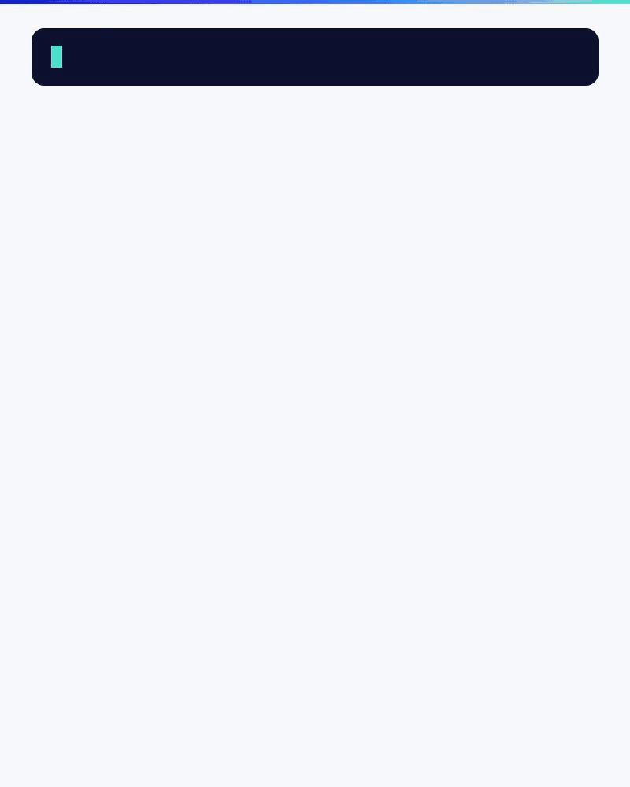

# Conferbot Flutter SDK

[](https://pub.dev/packages/conferbot_flutter)
[](https://flutter.dev)
[](https://dart.dev)
[](LICENSE)

Add your Conferbot chatbot, live chat and help centre to an iOS or Android Flutter app. The chat is drawn with native Flutter widgets (no WebView), and it does what the web widget does.

## Quickstart video

<!-- TODO(video): record the quickstart (install, bot id, ConferBotFAB, run), export docs/media/quickstart.gif and replace VIDEO_ID with the YouTube id. -->
<p align="center">
  <a href="https://youtu.be/VIDEO_ID"></a>
</p>

The complete flow, recorded on an Android emulator against production: open the widget, the bot loads with the flow builder's theme, a name question, a choice, and the next step.

<p align="center">
  
</p>

<p align="center"><a href="docs/demo.mp4">HD video (MP4)</a></p>

<p align="center">
  
  
  
</p>

---

## Contents

1. [Requirements](#requirements)
2. [Install](#install)
3. [Get your bot ID](#get-your-bot-id)
4. [Add the chat](#add-the-chat): [launcher](#a-floating-launcher-recommended), [full screen](#b-full-screen), [bottom sheet](#c-bottom-sheet), [home screen](#d-home-screen), [your own UI](#e-your-own-ui-headless)
5. [Sign users in](#sign-users-in)
6. [Push notifications](#push-notifications)
7. [Customising](#customising)
8. [Help centre](#help-centre)
9. [Your requests](#your-requests)
10. [Live chat and waiting](#live-chat-and-waiting)
11. [How bot flows run](#how-bot-flows-run)
12. [Events and API reference](#events-and-api-reference)
13. [Offline, persistence, analytics and endpoints](#offline-persistence-analytics-and-endpoints)
14. [Troubleshooting](#troubleshooting)
15. [Example app](#example-app)
16. [Contributing and testing](#contributing-and-testing)

## Requirements

| | Minimum | Where it comes from |
|---|---|---|
| Flutter | 3.10.0 | `pubspec.yaml` (`environment.flutter`) |
| Dart | 3.0.0 (below 4.0.0) | `pubspec.yaml` (`environment.sdk`) |
| Android | API 24 (Android 7.0) | the media and audio plugins the SDK depends on; `video_player_android` 2.9 sets `minSdkVersion 24` |
| iOS | 13.0 | `url_launcher_ios`, `shared_preferences_foundation`, `path_provider_foundation` and `video_player_avfoundation` set iOS 13.0 in their podspecs |

The package has no native code of its own. The minimum OS versions are those of the plugins it uses (`video_player`, `just_audio`, `audioplayers`, `record`, `file_picker`, `permission_handler`, `connectivity_plus`, `url_launcher`, `shared_preferences`, `path_provider`), at the versions `flutter pub get` resolves today. A later plugin release can raise them; `flutter build` says so when your app's minimum is too low.

## Install

### 1. Add the package

```yaml
# pubspec.yaml
dependencies:
  conferbot_flutter: ^2.0.0
  provider: ^6.1.1 # the SDK's state is a ChangeNotifier; you provide it with package:provider
```

```bash
flutter pub get
```

### 2. Initialise storage

Session persistence (on by default) uses Hive. Initialise it once before `runApp`:

```dart
void main() async {
  WidgetsFlutterBinding.ensureInitialized();
  await StorageService.init(); // required for session persistence
  runApp(const MyApp());
}
```

Or turn persistence off with `ConferBotConfig(enablePersistence: false)`.

### 3. Android

- Set `minSdk` to at least 24 in `android/app/build.gradle` (`minSdk = 24`).
- Release builds need the internet permission in `android/app/src/main/AndroidManifest.xml`. Flutter's template only adds it to the debug and profile manifests:

  ```xml
  <uses-permission android:name="android.permission.INTERNET"/>
  ```
- Voice messages: `record` adds `RECORD_AUDIO` itself; the SDK asks for it the first time the visitor records.
- A plain `http://` server (a local embed-server) needs `android:usesCleartextTraffic="true"` on `<application>`. Production is HTTPS, so leave it out of release builds.

### 4. iOS

```bash
cd ios && pod install && cd ..
```

- Set the platform to iOS 13 in `ios/Podfile` (`platform :ios, '13.0'`) and in Xcode's deployment target.
- Voice messages: add `NSMicrophoneUsageDescription` to `ios/Runner/Info.plist`. The SDK asks for the microphone through `permission_handler`, which needs the permission turned on in your `Podfile`'s `post_install` (`'PERMISSION_MICROPHONE=1'` in `GCC_PREPROCESSOR_DEFINITIONS`, as the [permission_handler setup](https://pub.dev/packages/permission_handler#setup) shows).
- File and photo steps: add `NSPhotoLibraryUsageDescription` (and `NSCameraUsageDescription` if visitors take photos) for `file_picker`.
- A plain `http://` server needs an App Transport Security exception (`NSAppTransportSecurity` > `NSAllowsArbitraryLoads` or `NSExceptionDomains`) for development only.

### 5. Optional packages

The SDK adds no Firebase, location or notification plugin. Add these only for the features you want:

| Package | Enables |
|---|---|
| [`firebase_messaging`](https://pub.dev/packages/firebase_messaging) (or any push plugin) | [Push notifications](#push-notifications): you hand the SDK the token and the taps |
| [`flutter_local_notifications`](https://pub.dev/packages/flutter_local_notifications) | Creating the Android channel `conferbot_messages` the server sends on |
| [`geolocator`](https://pub.dev/packages/geolocator) (or any location plugin) | "Use my location" on the address step ([Customising](#use-my-location-on-the-address-step)) |

Fonts and sounds need nothing extra: the SDK already depends on `audioplayers`, `http`, `path_provider` and `shared_preferences`.

## Get your bot ID

1. Sign in to the [Conferbot dashboard](https://app.conferbot.com) and open your bot.
2. **Publish** it (the builder's **Publish** button). An unpublished bot serves no flow.
3. Open the bot's **Share** tab. Under **Mobile apps**, pick **Flutter**: the snippet there already has your bot ID in it. The ID is also the 24-character hex string after `/chatbot/` in the dashboard's address bar.

The bot ID is the credential. The SDK still asks for an `apiKey`, but the mobile API doesn't check it: keep any placeholder (the dashboard's snippet fills one in).

No account yet? The public demo bot `691c970890527a0468f9b2c9` works without one. The example app ships with it.

## Add the chat

Create one `ConferBotProvider` near the top of your widget tree and keep it for the app's life. Every SDK widget reads it with `package:provider`.

### A. Floating launcher (recommended)

The web widget's bubble, in the corner of your app. It draws itself from the dashboard settings and opens the chat in a bottom sheet.

```dart
import 'package:flutter/material.dart';
import 'package:provider/provider.dart';
import 'package:conferbot_flutter/conferbot_flutter.dart';

void main() async {
  WidgetsFlutterBinding.ensureInitialized();
  await StorageService.init(); // session persistence (Hive)
  runApp(
    ChangeNotifierProvider(
      create: (_) => ConferBotProvider(
        apiKey: 'conf_placeholder', // any value; the bot id is the credential
        botId: 'YOUR_BOT_ID',
      ),
      child: const MyApp(),
    ),
  );
}

class MyApp extends StatelessWidget {
  const MyApp({super.key});

  @override
  Widget build(BuildContext context) {
    return MaterialApp(
      home: ConferBotFAB(
        child: Scaffold(
          appBar: AppBar(title: const Text('My App')),
          body: const Center(child: Text('Your app content')),
        ),
      ),
    );
  }
}
```

Or let `ConferBotFABScope` create the provider for you:

```dart
const ConferBotFABScope(
  apiKey: 'conf_placeholder',
  botId: 'YOUR_BOT_ID',
  child: MaterialApp(home: Scaffold(body: Center(child: Text('Your app content')))),
)
```

`ConferBotFABScope` takes `apiKey`, `botId`, `child` (required), plus `fabConfig` (`ConferBotFABConfig`), `providerConfig` (`ConferBotConfig`), `customization`, `user`, `baseUrl` and `socketUrl`.

`ConferBotFABConfig` holds fallbacks only. The dashboard's values win when the bot has them:

```dart
ConferBotFAB(
  config: const ConferBotFABConfig(position: FabPosition.left, size: 56, offsetBottom: 24),
  child: child,
)
```

What the bubble does:

- A tap opens the chat in a `showModalBottomSheet` (draggable, 92% of the screen's height); the icon becomes a close cross while it is open.
- A red badge counts messages that arrive while the chat is closed.
- The greeting card, the launcher's look and its motion follow the dashboard ([What the launcher draws](#what-the-launcher-draws)).

### B. Full screen

Push `ChatWidget` as a route. Re-provide the provider, because a new route is outside the widget that created it. The chat's close button pops the route.

```dart
void openChatScreen(BuildContext context) {
  Navigator.of(context).push(
    MaterialPageRoute(
      builder: (_) => ChangeNotifierProvider.value(
        value: context.read<ConferBotProvider>(),
        child: const ChatWidget(),
      ),
    ),
  );
}
```

`ChatWidget` is the whole chat: the header with the bot's name and avatar, the paginated message list, every step type the web widget runs, the offline banner, live chat, the help centre and the composer. It calls `openChat()` on the provider when it appears.

### C. Bottom sheet

Your own sheet, from any button:

```dart
Future<void> openChatSheet(BuildContext context) {
  final provider = context.read<ConferBotProvider>();
  return showModalBottomSheet<void>(
    context: context,
    isScrollControlled: true,
    useSafeArea: true,
    builder: (_) => ChangeNotifierProvider.value(
      value: provider,
      child: FractionallySizedBox(
        heightFactor: 0.92,
        child: const ChatWidget(),
      ),
    ),
  );
}
```

### D. Home screen

There is no separate widget for the home screen. When the owner turns it on (dashboard: Customize > Home, `enableInitialPage`), `ChatWidget` and the floating bubble open on it; with it off they open on the conversation. The chat header's ‹ and Android's back go from the conversation to the home.

To steer it from code:

```dart
final provider = context.read<ConferBotProvider>();
final hasHome = provider.homeModel != null; // null when the owner has no home screen
provider.home.showChat('Where is my order?'); // to the conversation, asking this there
provider.home.showHelp();                     // the help centre
provider.home.showHome();                     // back to the home screen
```

What it shows is described in [Home screen](#home-screen-details).

### E. Your own UI (headless)

`ConferBotProvider` is a `ChangeNotifier`, and the SDK works without its widgets:

```dart
final provider = context.watch<ConferBotProvider>();

// State
final messages = provider.record;            // List<RecordItem>
final connected = provider.isConnected;
final agent = provider.currentAgent;         // Agent? during a live chat
final uiState = provider.currentUIState;     // the step waiting for an answer
final done = provider.isFlowComplete;

// Actions
await provider.openChat();                   // start or resume the session
await provider.sendMessage('Hello!');        // typed answer / live chat message
provider.submitResponse({'buttonId': 'b1'}); // answer the waiting step
provider.initiateHandover(message: 'I need a human');
provider.sendTypingStatus(true);
provider.resetConversation();
```

Build your own step UI from `currentUIState` (typed states like `SingleChoiceUIState`, `RatingUIState`, `CalendarUIState`, `CarouselUIState`, `SliderUIState`, `MatrixUIState`, ...), or reuse the SDK's `NodeRenderer`. Answer with `submitResponse` in the shape the step reads ([How bot flows run](#how-bot-flows-run)). The building blocks are exported too: `ChatHeader`, `MessageList`, `SimpleMessageList`, `MessageBubble`, `ChatInput`, `ChatBottomBar`, `TypingIndicator`, `ConnectionStatus`, `OfflineIndicator`, `Avatar`, `EmptyState`.

## Sign users in

### Pass the user

```dart
ConferBotProvider(
  apiKey: 'conf_placeholder',
  botId: 'YOUR_BOT_ID',
  user: ConferBotUser(
    id: 'user-42',                    // required
    name: 'Jane Doe',
    email: 'jane@example.com',
    phone: '+15551234567',
    metadata: const {'plan': 'pro', 'company': 'Acme'},
    hash: hashFromYourServer,         // identity verification, below
  ),
)
```

When a chat session starts, the SDK calls `POST /session/init` with `userId: user.id` (else the generated visitor id), so conversations are attributed to your user across sessions. The whole user (its `metadata`, then `id`, `name`, `email`, `phone`) also goes with every message record as the visitor context, as the web widget's `visitorContext` does, so the dashboard shows the visitor's name, email and your own fields. Without a user, the SDK makes an anonymous visitor id, keeps it in Hive and reuses it after restarts.

### Identity verification

Without it, anyone could claim any id or email. Turn it on in the dashboard (Workspace settings > Team & security > Security > **Identity verification**), keep the secret on your server, and sign each user there: the HMAC-SHA256 (hex) of the user's `id` (or `email` when there is no id).

```js
// Node, on your server. Never ship the secret in the app.
const crypto = require("crypto");

const secret = process.env.CONFERBOT_IDENTITY_SECRET;
const hash = crypto.createHmac("sha256", secret).update(String(user.id || user.email)).digest("hex");
// Send `hash` to the app with the signed-in user.
```

Pass it as `ConferBotUser.hash`. The server checks the hash and drops it before storing. A chat with a matching hash is filed as verified (contacts link and merge). A wrong hash is rejected, and no hash leaves the chat unverified, or anonymous when the workspace requires verification.

### Signing in or out later

When someone signs in or out after the chat is up, tell the provider (as `identify(user:)` on iOS and `Conferbot.identify` on Android):

```dart
context.read<ConferBotProvider>().identify(
  ConferBotUser(id: 'user-42', email: 'jane@example.com', hash: hashFromYourServer),
);

// Signed out:
context.read<ConferBotProvider>().identify(null);
```

From then on the message records carry the new user (with its `hash`). "Your requests" is read again for them (a signed-out user's list is dropped), greeting rules that ask whether the visitor is signed in decide again, and the owner's "Greet by name" texts are filled again ([Greet by name](#greet-by-name)). `identify(null)` also unregisters the push token. With no stored visitor id, the user's id goes with the next socket handshake and session. A conversation already going keeps its session.

## Push notifications

When an agent or the AI replies while the visitor is not in the chat (the app is in the background or closed), the Conferbot server sends a push: FCM on Android, APNs on iOS. Push is off until your app hands the SDK a token.

1. Get the token with your push plugin, e.g. `firebase_messaging` (`FirebaseMessaging.instance.getToken()`, an FCM token on both platforms), or the APNs device token as hex.
2. Pass it to the provider. It is registered with the current conversation (`POST /api/v1/mobile/push/register` with `chatSessionId` and `tokenType`), again for each new conversation, and unregistered on `identify(null)` (or another user), `clearAllPersistedData()`, `clearCurrentSession()` and `unregisterPush()`.
3. Forward notifications to `handlePushNotification`. It returns `true` when it was this bot's Conferbot message, and opens its conversation (the chat, or that conversation in "Your requests"). A tap that started the app is opened once start-up is done.

With `firebase_messaging` 15:

```dart
Future<void> wirePush(ConferBotProvider provider) async {
  final messaging = FirebaseMessaging.instance;
  await messaging.requestPermission();
  final token = await messaging.getToken();
  if (token != null) await provider.setPushToken(token, PushTokenType.fcm);
  messaging.onTokenRefresh.listen((t) => provider.setPushToken(t, PushTokenType.fcm));

  // Tapped while in the background, or the tap that started the app.
  FirebaseMessaging.onMessageOpenedApp.listen((m) => provider.handlePushNotification(m.data));
  final initial = await messaging.getInitialMessage();
  if (initial != null) provider.handlePushNotification(initial.data);

  // Arrived in the foreground: count it as unread instead of taking the screen.
  FirebaseMessaging.onMessage.listen((m) => provider.handlePushNotification(m.data, open: false));
}
```

- `setPushToken(String? token, [PushTokenType? type])`: an iOS app using `firebase_messaging` passes `PushTokenType.fcm`. Without a type, a 64-character hex token is taken as APNs. `setPushToken(null)` unregisters.
- `handlePushNotification(Map<String, dynamic>? data, {bool open = true})` takes the notification's data map (`RemoteMessage.data`, an APNs `userInfo`). Outside the provider, `ConferbotPush.parse(data)` / `ConferbotPush.isConferbot(data)` say whether a notification is Conferbot's (data `source: "conferbot"`, `type: "conferbot_message"`, `botId`, `chatSessionId`, `messageId`, `senderType`, `senderName`, `body`).
- Android: the server sends on the channel `conferbot_messages` (`pushChannelId`). The SDK draws no notifications: create that channel in your app (e.g. with `flutter_local_notifications`) so the visitor can control it. Otherwise Android uses its fallback channel. One notification per conversation (collapse key / tag and iOS `thread-id` = the conversation).
- `registerPushToken(token)` still works. It is `setPushToken(token)`, and no longer waits for an open chat.

Server side: sending is off until the embed-server has `MOBILE_PUSH_ENABLED=true` and the FCM / APNs credentials (embed-server `docs/mobile-push.md`). The credentials are platform-wide for now, so pushes reach only apps built on Conferbot's Firebase project and bundle id. Your own app's Firebase project and bundle id need per-workspace credentials, which are not built yet (embed-server #197). Until then its tokens register, but FCM / APNs refuse its pushes.

## Customising

### What the dashboard controls and what code controls

| Set in the dashboard (applies on its own) | Set in your app's code |
|---|---|
| Colours, widget theme and dark mode, chat background, bubble and option shapes | `ChatWidget(theme:)`, used only when the bot sends no customizations ([precedence](#precedence-server-settings-override-a-local-theme)) |
| Launcher: icon, colour, shape, style, size, position, motion, entrance, attention, idle call, mascot | `ConferBotFABConfig` fallbacks (size, position, offsets) |
| Greeting card, its rules, style and frequency | `user` (greeting rules for signed-in visitors) |
| Home screen, help centre switch, Recent articles | `ChatWidget(showKnowledgeBase:)` override, `provider.home.*` |
| Widget language | `ConferBotConfig(widgetLanguage:)` (wins) |
| Font | `ConferBotCustomization(fontFamily:)`: only the fallback while the owner's font loads, or when the bot sets none |
| Sounds, auto-open, typing preview, human touches | Sound on / off is the visitor's, in the chat menu |
| Post-chat redirect URL | `ConferBotConfig(onPostChatRedirect:, disablePostChatRedirect:)` |
| Flow steps, handover, waiting games, post-chat rating | `ConferBotConfig(locationProvider:)` for "Use my location" |

### What the launcher draws

Once the bot's settings arrive, the launcher is drawn as the web widget draws it on a phone: colour or left-to-right gradient, icon ink that stays readable on light colours, launcher icon or uploaded image, left/right position, the phone size and offsets (`mobileWidgetSize`, `mobileOffsetBottom`, `mobileOffsetSide`; else 16 from the edges), shape (`launcherShape`: speech bubble by default, circle, squircle, tab, peek), style (`launcherStyle`: icon, the bot's avatar with an online dot, the label pill on tablets (phones show the round button, as the web does), or your mascot, below; an uploaded image always wins), a soft glow in the header colour, and the greeting card. All 56 dashboard launcher icons are drawn as on the web, and they move as on the web: an idle moment about 2s after the launcher shows and a few more after (`launcherAnimation` subtle / lively; off stops it), a reaction when a message arrives while the chat is closed, and the ripple rings. Nothing moves while the chat is open, after it was opened, or with the phone's animations turned off.

**The greeting card** shows above the bubble when the greeting is on (`chatIconCta` + `chatIconCtaText`, or greeting rules), after `greetingDelay` seconds (default 3), in the dashboard's `greetingStyle`: card, note, imessage (default), postcard, sticky, typewriter, glass, notification, neon, voice or aurora, each with its web reveal. Greeting rules work as on the web, with the app counted as the home page ("/"): audience (new/returning, signed in = the provider `user` has an id or email), schedule, visits, chatted, per-rule limits and priority. Rules for given pages, countries, sources or page attributes never apply. `greetingFrequency` is honoured: every launch with a 5-minute rest after a close, once per app session, or once every N days. Tapping the card opens the chat (or sends the message, or opens the rule's link); a starter chip opens the chat and sends that text; the X dismisses it. What it has seen is kept per bot in `shared_preferences` under `conferbot.greeting.<botId>`. The card uses the platform's nearest fonts (Noteworthy / Marker Felt / Georgia / Courier New on iOS; casual / serif / monospace on Android). No fonts are bundled.

**Your mascot.** The mascot you design in the dashboard: one of 27 characters (`mascotShape`) with its eyes (`mascotEyes`), accessory (`mascotAccessory`), colour (`mascotColor`, else the launcher's) and name (`mascotName`).

- The `mascot` launcher style shows its head over a soft light button at `mascotLauncherScale`% of the button (70-150, 112 by default), blinking now and then, and hopping with a big smile when a reply arrives while the chat is closed. Open, the button is the brand colour with its cross.
- `mascotInGreeting` puts it on the greeting card in place of the avatar, by its name, waving twice.
- `mascotMotion` sets how the greeting card and its figure (the mascot or the avatar) move: lively (the default: the card springs up, the figure pops in, waves and nods, the Online dot pings once, the words fade up, then a slow breath and at most three small gestures before it stands still), subtle (a rise, the ping and one tilt) or off. Opened from the card, the figure hands off toward the launcher as the card collapses; the card's x makes it bow as the card fades. A voice-note card makes it talk while the waveform plays. No gestures while the app is in the background.
- The idle call (below) sends your mascot out, about its own joints.
- With the phone's animations off it stands still (a happy one keeps its smile). Glows and the bevel are not drawn.

Three more effects are opt-in from the dashboard, all off by default, as on the web:

- **Entrance** (`launcherEntrance`): classic (it just appears) or lightning, rocket, portal, ufo, drop, confetti, coin, meteor, magic, parachute, plane, egg. It plays once per app session per bot, never over an open chat. The launcher is hidden until the effect reveals it (a tap still opens the chat and ends it); the greeting card stays hidden until the launcher has landed, then fades up 150 ms later.
- **Attention** (`launcherAttention`): off, pulse, wobble, bounce, wave, float, shine, heartbeat, orbit. The first beat comes 1.5s after the launcher (or, for wave and float, the greeting card) shows, then one beat per lap. It pauses while the launcher plays an idle or message moment and stops for the session once the chat is opened. While it moves the launcher, the idle moments and the three load ripples give way to it.
- **Idle call** (`launcherIdleCall`, `launcherIdleCallDelay` 5-120s, default 12; `launcherIdleCallText`, 24 characters): off, psst, peek, wave, knock, tap. If the chat has not been opened, your mascot slips out from behind the launcher and calls the visitor; its speech bubble opens the chat. At most twice per app session, 3 minutes apart, then 3 days of rest (also after the chat is opened); closing the greeting stops calls for the session. It waits while the chat is open, the app is in the background, the keyboard is up, an entrance is landing, or the greeting has been up less than 15s. With the greeting up there is no bubble.

None of them plays with the phone's animations turned off. Glows, blurs and other web filters are not drawn.

The bubble's settings, read live from the server (they override `ConferBotFABConfig`):

| Dashboard setting | Effect |
|---|---|
| `widgetIconBgColor` (fallback `headerBgColor`) | Bubble colour (default `#1B55F3`) |
| `widgetSize` | Bubble diameter |
| `widgetPosition` | `left` or right side |
| `widgetOffsetLeft` / `widgetOffsetRight` / `widgetOffsetBottom` | Edge offsets |
| `widgetBorderRadius` | Bubble corner radius (default: circle) |
| `widgetIconSVG` | Which bubble icon to draw |
| `chatIconCta`, `chatIconCtaText`, `greetingRules`, `greetingDelay`, `greetingClickAction`, `greetingFrequency`, `greetingFrequencyDays`, `greetingStyle` | Greeting card above the bubble |
| `launcherStyle: mascot`, `mascotShape`, `mascotEyes`, `mascotAccessory`, `mascotColor`, `mascotName`, `mascotLauncherScale`, `mascotInGreeting`, `mascotMotion` | Your mascot: in the launcher, on the greeting card, in the idle call and the typing bubble |

### Colours and themes

When the widget connects, the server sends the bot's flow-builder customizations (the same ones the web widget uses): header colours, bubble colours, chat background, bot name, bot avatar, font size and bubble border radius. The SDK builds a theme from them (`ConferBotProvider.serverTheme`) and applies it with no code on your side.

- **Chat background**: solid, gradient (linear, radial, mesh, blur), image with its mask, or one of the 13 patterns.
- **Widget theme**: all 27 dashboard themes (Classic, Minimal, Glass, Neo-brutal, Midnight, Aurora and the rest). Each brings its surfaces, text colours, corner radii and bubble outline, as on the web widget. **Appearance** light, dark, or auto (follows the phone's dark mode, also when it changes while the chat is open); Midnight, Neon, Chalkboard, Cyberpunk and Space are always dark. **Colours** "Brand" keeps your colours; "Theme palette" swaps in the theme's own header, bubble, option, launcher and send-button colours (`serverCustomizations` then carries them). Your own bubble radius, option radius and chat background still win over the theme. `ConferBotProvider.widgetTheme` exposes the theme in force.

Keys read from the dashboard: `headerBgColor`, `headerTextColor`, `botMsgColor`, `botTextColor`, `userMsgColor`, `userTextColor`, `optionBubbleMsgColor`, `optionBubbleTextColor`, `chatBgColor`, `fontSize`, `bubbleBorderRadius`, plus `botName` / `logoText` (header title) and `avatar` / `logo` (header and message avatar).

#### Precedence: server settings override a local theme

From `ChatWidget.build`:

```dart
final effectiveTheme = provider.serverCustomizations != null
    ? provider.serverTheme
    : (widget.theme ?? defaultTheme);
```

1. If the server sent customizations, **`serverTheme` is used and your local `theme:` is ignored** for the chat. `serverTheme` is `defaultTheme` with the dashboard values merged over it; a colour the dashboard leaves out falls back to the web widget's defaults (`#1B55F3` bubbles, white text).
2. If the server sent nothing (offline before the first fetch, for example), your local `theme:` applies.
3. Otherwise `defaultTheme` (light) applies.

The FAB follows the same rule: server bubble settings win over `ConferBotFABConfig`. If you want your own branding to win, leave the colours at their defaults in the bot's appearance settings and pass a local theme.

#### Local themes

```dart
// Built-ins
ChatWidget(theme: defaultTheme); // light
ChatWidget(theme: darkTheme);    // dark

// Custom: start from a built-in and override
final brandTheme = defaultTheme.copyWith(
  colors: defaultTheme.colors.copyWith(
    primary: const Color(0xFF6366F1),
    headerBg: const Color(0xFF6366F1),
    userBubble: const Color(0xFF6366F1),
    botBubble: const Color(0xFFF3F4F6),
  ),
  borderRadius: const ConferBotBorderRadius(bubble: 20.0),
);

ChatWidget(theme: brandTheme);
```

`ConferBotTheme` is made of `ConferBotColors`, `ConferBotTypography`, `ConferBotSpacing`, `ConferBotBorderRadius`, `ConferBotShadows`, `ConferBotAnimations` and `ConferBotLayout` (colors have a full `copyWith`; the others are const-constructible with named defaults).

The provider also takes a `ConferBotCustomization` (`primaryColor`, `fontFamily`, `bubbleRadius`, `headerTitle`, `enableAvatar`, `avatarUrl`, `botBubbleColor`, `userBubbleColor`). Only `fontFamily` is applied (the chat's font when the bot sets none, see Fonts below); the rest is stored. Use `ConferBotTheme` for local styling.

### Languages

The SDK draws its own words in English, Dutch, French, German or Spanish, with the web widget's wording:

1. `ConferBotConfig(widgetLanguage: 'de')`, when the app sets it ("en", "nl", "fr", "de", "es" or "auto").
2. Otherwise the language the owner picked in the dashboard (`widgetLanguage`).
3. "Auto" (and every bot that never chose): the first of the phone's languages the widget speaks (`PlatformDispatcher.locales`, most preferred first).
4. Otherwise English.

```dart
ConferBotProvider(
  apiKey: 'conf_placeholder',
  botId: 'YOUR_BOT_ID',
  config: const ConferBotConfig(widgetLanguage: 'de'),
)
```

What the owner wrote (greetings, questions, buttons, articles) is shown as written; the stock English texts a new bot starts with ("We're here to help", "Hi there 👋") are shown in the visitor's language. Dates, times, day and month names and "5 min ago" follow the language too, keeping the phone's region when it speaks the same language ("nl-BE"). The provider tells its listeners when the language changes. The words come from the table all Conferbot SDKs share: `sh tool/sync_i18n.sh` rebuilds `lib/src/core/i18n/` from the React Native SDK's `scripts/parity/i18n/strings.json` (`--check` says whether it is up to date).

### Fonts, sounds and the owner's other settings

These dashboard settings apply on their own; nothing needs to be added to the app.

- **Font**: the owner's font (any of the dashboard's Google fonts) wins, for all text; else the widget theme's font, for all text ("body" themes) or only the header title ("display" themes). It is fetched from Google Fonts on first use, kept on the device and registered at run time under a "CB Font <family>" name your app's own text never picks up. A system font the owner picked (Georgia, Verdana...) is used by name, so a family your app bundles is picked up. Offline, or before it has loaded, the chat uses `ConferBotCustomization.fontFamily`, else the platform font. Applied to the whole chat: the header, the bubbles, the composer, the home screen and the step cards.
- **Sounds** (`messageSound` pop / chime / bubble; a `soundPack` soft / playful / retro / bubbly / premium for opening, a message, sending and closing; the launcher sound file): the web's own tones, rendered on the phone as a small WAV, at most one message sound every 0.8s. The chat menu has Sound on / off when the bot has a sound; the choice is kept on the device (`conferbot-sound-enabled`). They play as interface sounds: iOS's silent switch mutes them and other audio keeps playing; on Android they follow the ringer and Do Not Disturb.
- **Human touches** (`botReactions`, `celebrations`, `stallNudges`, `allowChangeAnswer`; all on unless turned off): the bot's tapback on an answer that deserves one (a wave for a name, a party for a booking or payment, a heart, thumbs up or thank-you for a score), a second of confetti for a booking, a payment or a perfect score, sparks and the pick's word on a star rating, "No rush - ..." under a question that has waited 40s with the chat on screen and nothing typed, and "Edit" under the visitor's latest answer, which takes the conversation back to that question (only while nothing irreversible, such as a booking, a payment, a file or a person joining, happened since). No confetti or sparks with reduced motion (`MediaQuery.disableAnimations`); no haptics.
- **Auto-open** (`botAutoOpen`, `botAutoOpenDelay` seconds): the floating bubble opens the chat on its own once per app launch, only before the visitor has a conversation and not within 2 minutes of them closing it.
- **Typing preview** (`visitorDraftPreview`, on unless turned off): while a person is chatting with the visitor, the agent sees what is being typed (`visitor-draft`, at most every 300ms, never for a secret field).
- **Typing indicator** (`typingStyle`): dots, wave, shimmer, a pencil writing a line, or your mascot swaying by three thought dots ("Pip is typing" for screen readers when you named it).
- **Calendar**: slots already booked (the bot's bookings) show greyed out and cannot be picked; a day with every slot taken is not offered.
- **Waiting for a person**: the wait card says the live estimate in the visitor's language, else the team's usual wait ("Typical wait: a few minutes"), unless the owner chose a fixed text or hid the reply time. Under it the handover step's max wait counts down once a second ("Max wait 1:05"), stopping at 0:00; after a restart it counts from the time the server says is left. The header's small queue indicator shows the same time, from the same deadline (`liveChat.waitEndsAt`), and no time when there is none.
- **Post-chat rating**: when the owner has post-chat feedback on, the rating is offered 1.5 s after the flow reaches its end, as well as when an agent ends the chat; once per conversation, and not again after a restart.

### Redirect after chat

When the owner sets a URL in Customize > Conversations > Post-chat redirect, the SDK follows it as the web widget does: once the conversation ends (the flow reaches its end, or an agent ends the chat) and the post-chat rating is sent or put away, a quiet line reads "Taking you to example.com in 10s" with Cancel, then the URL opens in the system browser (`url_launcher`, outside the app). It stops if the visitor cancels, starts a new chat, closes the chat or the app goes to the background, and it is offered only once per conversation (remembered in `shared_preferences`). Only `http(s)` addresses are followed.

```dart
ConferBotProvider(
  apiKey: 'conf_placeholder',
  botId: 'YOUR_BOT_ID',
  config: ConferBotConfig(
    // Open it in your own screen instead; true = handled, no countdown.
    onPostChatRedirect: (url) {
      navigatorKey.currentState?.pushNamed('/web', arguments: url);
      return true;
    },
    // Or turn it off: disablePostChatRedirect: true,
  ),
);
```

Headless: `provider.postChatRedirect.line` (`RedirectLine`: `text`, `said`, `phase`, `cancelLabel`), `provider.postChatRedirect.cancel()`, `continueNow()`.

### Use my location on the address step

The SDK reads no position itself and adds no location plugin, so "Use my location" is optional: give `ConferBotConfig` a `locationProvider` and the address card draws the button (while the owner's step allows it, `allowMyLocation`). Without one there is no button; search, the map and typing the address by hand work as before. The provider returns the device's position, `null` when it cannot be found, or throws `ConferBotLocationDenied` when access is refused (the card then says location access is turned off). The SDK asks the bot's server for the address there (`geo/reverse`) and the visitor confirms it on the map, as a picked suggestion.

With [`geolocator`](https://pub.dev/packages/geolocator) in your app (add it to your `pubspec.yaml` and the platform's location permission: `NSLocationWhenInUseUsageDescription` in iOS `Info.plist`, `ACCESS_COARSE_LOCATION` / `ACCESS_FINE_LOCATION` in the Android manifest):

```dart
import 'package:conferbot_flutter/conferbot_flutter.dart';
import 'package:geolocator/geolocator.dart';

Future<ConferBotLatLng?> deviceLocation() async {
  if (!await Geolocator.isLocationServiceEnabled()) return null;
  var permission = await Geolocator.checkPermission();
  if (permission == LocationPermission.denied) permission = await Geolocator.requestPermission();
  if (permission == LocationPermission.denied || permission == LocationPermission.deniedForever) {
    throw const ConferBotLocationDenied();
  }
  final p = await Geolocator.getCurrentPosition(
    locationSettings: const LocationSettings(accuracy: LocationAccuracy.medium, timeLimit: Duration(seconds: 10)),
  );
  return ConferBotLatLng(p.latitude, p.longitude);
}

ConferBotProvider(
  apiKey: 'conf_placeholder',
  botId: 'YOUR_BOT_ID',
  config: ConferBotConfig(locationProvider: deviceLocation),
);
```

A headless `NodeRenderer` takes `locationProvider:` too (else it uses the chat's `ConferBotConfig`). The SDK gives up after 10 seconds without an answer.

### Hooks for your app

| Hook | Where | What for |
|---|---|---|
| `onPostChatRedirect: bool Function(String url)` | `ConferBotConfig` | Handle the owner's redirect yourself (return `true`) |
| `locationProvider: ConferBotLocationProvider` | `ConferBotConfig` | "Use my location" |
| `onArticleInsert: ValueChanged<KnowledgeBaseArticle>` | `ChatWidget` | A help article inserted into the chat |
| `onHandoverSurveySubmit: ValueChanged<SurveyResult>` | `ChatWidget` | The post-chat survey was sent |
| `homeMascotBuilder` | `ChatWidget` | Your mascot on the home screen |
| `onWidgetSignal(name, listener)` | provider | The waiting signals ([Events](#events)) |
| `on(event, callback)` | provider | Raw socket events ([Events](#events)) |
| `addListener` | provider | Any state change (it is a `ChangeNotifier`) |

## Help centre

The help centre follows the owner's dashboard settings, as on the web widget:

- The help button shows in the `ChatWidget` header while **Help articles** (`enableKnowledgeBase`) is on and at least one article is published. With it off, or with no published article, there is no button.
- **Recent articles** shows above the full list unless the owner hides it (`hideRecentArticles`).
- Article bodies are HTML and are drawn as such. The list comes with the bot's settings on connect (titles and descriptions only); an article's body is fetched when it is opened.
- When an AI answer cites a help centre article (a source with an `articleId`), it says "Help article ›" and opens that article in the help centre, while the help centre is on (the owner's switch, or `showKnowledgeBase`). Otherwise a source with a public link shows its site and opens the link; one without is drawn but not tappable.
- An AI article card opens its public page when it has one, else the article in the help centre while it is on.
- Search matches titles and descriptions at once, and inside article bodies through the chat's socket (`search-kb-articles`), with the matching passage under the title; over REST (`/knowledge-base/search`) when the socket is not connected or does not answer.
- An article ends with "Was this helpful?" and thumbs up / down, as on the web (`rate-article`, once per article per session; 5 for helpful, 1 for not; over REST without a socket). A thumbs down offers "Chat with us". How long the article was read and how far it was scrolled go to the dashboard's article analytics when the visitor leaves it (`track-article-engagement`, from 2 seconds; read to the end at 90%).

`ChatWidget(showKnowledgeBase:)` overrides the owner's switch:

| `showKnowledgeBase` | Help button |
|---|---|
| `null` (default) | follows `enableKnowledgeBase` and needs a published article |
| `false` | never |
| `true` | always, even with the owner's switch off (the screen then loads the articles over REST) |

You can also show the help centre on its own screen. It reads from the configured server (`ConferBotEndpoints` or `baseUrl`):

```dart
ChangeNotifierProvider(
  create: (_) => KnowledgeBaseProvider(
    apiKey: 'conf_placeholder',
    botId: 'YOUR_BOT_ID',
    link: provider.helpCentreLink, // optional: the chat's socket, for search, ratings and views
  ),
  child: const KnowledgeBaseScreen(
    title: 'Help Center',
    showCategories: true,
    showSearch: true,
  ),
)
```

Without `link` there is no chat socket, so search, ratings and views use REST. `KnowledgeBaseService` has the REST calls under `/mobile/knowledge-base`: `fetchHelpCentre` (categories with their articles, and the recent articles), `fetchCategories`, `fetchArticles`, `fetchArticle`, `searchArticles` (sends `query`), ratings and view tracking. `KnowledgeBaseProvider.openArticle(id)` opens an article by id.

## Your requests

As the web widget's "Your requests": the visitor's own conversations with your team, where each one stands in plain words ("We replied", "We're on it", "Solved"), and a reply box that reaches the team. A reply to a solved one opens it again.

- **Where:** on the [home screen](#home-screen-details) (up to two, "See all (n)", above "Talk to us" when a reply is new) and in the chat menu (the header's ⋮): **Your requests** once the visitor has one, **Your requests · New reply** when a team reply has not been read on this device. It opens over the home screen or the chat: the list (new replies first, "New reply from Ada · 2 hours ago"), then one request with a banner, the conversation (links tappable) and the reply box (Sending..., Not sent with Try again, or "This conversation is closed for replies."). Back and Android's back go one step back. Team replies show up live while a request is open.
- **Whose they are:** only the visitor's own. The device remembers, per bot, the last 30 chats the visitor wrote in and when each request was last read (shared_preferences), and the server lists a conversation only when its id is one of those and its visitor id matches. A signed-in user (`ConferBotUser` with a valid `hash`, see [Identity verification](#identity-verification)) also sees their verified conversations on this bot from any device, read again when they sign in or out with `identify`. Only conversations a person on the team handles are requests; a chat the AI answered alone is not one. Nothing is asked for a first-time visitor.
- **Look:** the theme's page, card and text colours, one accent (the bot's brand colour, else its header or launcher colour, else indigo), and the app's `ConferBotCustomization.fontFamily`. It slides in once (not with animations turned off).

Headless: `provider.myRequests` (`List<RequestSummary>?`), `provider.requestsUnread` (for your own badge), `provider.openRequests([requestId])`, `provider.closeRequests()`, `provider.requestsOpen`; `provider.requests.portal` (`RequestsPortal`, a `ChangeNotifier` with `state` and the actions) is drawn by `RequestsPortalView`.

```dart
Badge(
  isLabelVisible: provider.requestsUnread > 0,
  label: Text('${provider.requestsUnread}'),
  child: IconButton(icon: const Icon(Icons.inbox_outlined), onPressed: () => provider.openRequests()),
)
```

### Home screen details

When the owner turns on the home screen (Customize > Home, `enableInitialPage`), the chat opens on it, as the web widget does; with it off the chat opens straight on the conversation. It follows the owner's settings:

- **Header:** "Good morning" / "Good afternoon" / "Good evening" by the phone's clock, or "Welcome back, Jamie" when the visitor has written before (the device remembers their first name and the first real question of their latest conversation for 60 days, per bot, in shared_preferences). The bot's logo and name (none with `hideLogo`), the owner's title (`initialPageTitle`) and description (`initialPageDescription`; an early bot's placeholder copy becomes "Ask us anything - we're here to help."), on a band in the launcher's colours.
- **Ask anything** (`homeAskBox`, on unless off; only with an AI agent or a published article): for an AI agent, "Ask “...”" opens the conversation and asks it; the help articles that answer it (the server's search inside article text too); for a flow bot with nothing found, "Chat with us".
- **Pick up where you left off** (AI agent bots): opens the conversation still on the device, else asks the remembered question again.
- **Your requests:** two rows and "See all (n)"; above "Talk to us" when a team reply is new. Opens the requests portal over the home.
- **Talk to us:** the card's face (`initialPageAvatar`, else the bot's avatar or logo), "Online" with a green dot (none with `hideOnlineStatus`) and the reply time ("Usually replies in a few minutes", "Team back tomorrow 9 AM", "Answers instantly, day or night"; `replyTime`), the team's photos (`homeTeamPhotos`, up to 3), the button (`initialPageCardButtonText`, else "Chat with us"), up to 3 of an AI agent's questions, the rating (`homeRating`).
- **Help card** (`enableKnowledgeBase` with a published article): Recent articles (not with `hideRecentArticles`), the topics, See all; its own search when the ask box is off. Articles and topics open the help centre; its Back returns to the home.
- **Customer logos** (`homeTrustLogos`, https only, with `homeTrustLabel`), shown once one has loaded.
- **Moving between views:** the chat header's ‹ and Android's back go from the conversation to the home; the home's cross closes the chat. A greeting card's "send" (and its questions) go past the home to the conversation. The views switch in the owner's `viewTransition` / `viewTransitionDirection`: fade, slide, and every other kind as a slide; classic and none at once; a 200ms fade with the phone's animations off.

Calm and in the bot's look: the widget theme's page, cards and text (light or dark), one accent, the app's `ConferBotCustomization.fontFamily`. Each part rises into place once, never with animations off. Not in apps: the web's page-aware parts ("For this page" articles), which need a web page.

The web's home has no mascot. To put yours on the home, or anywhere in your app (moods: idle, wave, think, happy):

```dart
ChatWidget(homeMascotBuilder: (context, m) => Mascot(look: m.look, accent: m.accent, size: 56, mood: 'wave'));
Mascot(look: provider.customizations.mascot, accent: provider.customizations.mascotAccent, mood: 'think');
```

Headless: `provider.homeModel` (`HomeModel?`, everything the screen draws, null without a home), `provider.homePalette`, and `provider.home` (`HomeExtras`): `view`, `chosen` (a `ValueNotifier<HomeView?>`), `showHome()`, `showChat([text])`, `showHelp({categoryId})`, `back()`, `memory`, `searchArticleText(query)`. `HomeScreenView` and `ViewSwitch` are exported for your own chat screen.

### Greet by name

The owner's texts may greet the visitor by name: `{{first_name|there}}`, `{{name}}`, `{{company|your team}}` (the part after the bar is the fallback). The SDK fills them from the signed-in user (`ConferBotUser.name`, or `firstName` / `lastName` / `company` in its `metadata`) and a name the chat asked for, before anything reads the settings: the greeting card, the launcher's call-to-action and the home screen's title, description and button all show "Hi Sam", or "Hi there" when the name is not known. `identify` fills them again.

## Live chat and waiting

### Handover lifecycle

As on the web widget:

- When an AI agent hands the visitor to the team, the conversation shows "Connecting you with the team…" with typing dots. The line settles to how the wait ended: "Connected with the team", "The team couldn't join just now", "You left the queue" or "Chat ended before the team joined". An AI pausing an idle visitor draws nothing.
- When the handover step's max wait runs out with nobody there, the server is asked to decide (`handover-timeout`). After an AI escalates, the server owns the wait; only if nothing has happened by the step's max wait plus 30 seconds is it nudged with `handover-timeout` (an agent bot's own silent handover step gives the max wait). Nothing is drawn, and anything that ends the wait (a person or the AI accepting, `handover-waiting`, nobody available, leaving the queue, the chat ending or closing for inactivity, a blocked visitor) clears it.
- When the AI closes an idle conversation (`ai-agent-inactive-close`), the conversation shows "Chat paused" with "Send a message to pick up where you left off": the composer stays on and the visitor's next message brings the AI back. When the agent's close action is `continue_flow` on a flow bot, it shows "Chat ended" instead, the live chat is over and the flow carries on from its handover step's next edge (no survey). An agent bot is only ever paused. The line is recorded once, so a restart shows the same one.
- A person joining draws "<name> joined the chat" (with "They can see your conversation so far" after an AI handover), once per person.
- The header keeps the bot's name. Under it: the team's reply time ("Typically replies in a few minutes", "Online · team back Monday 9 AM", "Online · team replies by email"), or plain "Online" once a person is in the chat. `provider.headerStatus` gives the same words.
- The handover step's wait card has **Leave queue** (`provider.leaveQueue()`). It sends `queue-self-resolve`, so the team stops seeing the visitor waiting, and the flow carries on. It returns `false` when a person has already picked the chat up; the visitor then stays.
- An AI agent bot offers "Talk to a person" (when the owner turned it on) only while no handover is under way and nobody is here; it goes once tapped.
- The handover request carries the step's settings: `enableHandoverEmail` (false keeps the team's email off), the sound settings, and `assignmentMethod` / `requiredSkills`.
- When the agent leaves and the chat goes back to the queue (`live-chat-requeued`), "Connecting you to another agent..." (or "Connecting you to Sales..." after a team transfer) is drawn, and a flow at its handover step waits again. A transfer (`live-chat-transferred`) is kept in the conversation's record, not drawn.
- The same end twice (an agent's double click) draws one "Chat has ended" line and one survey; each end has its own record id. Once the chat has ended and nothing is going on, the composer turns off and **Start a new chat** (`provider.startNewChat()`) starts a fresh conversation.
- A visitor the workspace blocked sees "This conversation has been closed." (mid-chat, or at connect: the visitor id goes with the socket handshake) and can't type or start a new chat. `provider.visitorBlocked` and `provider.closedState` say so.
- When the live chat ends, the handover step's post-chat survey questions are asked if the builder turned on `enablePostChatSurveyQuestions`.
- A restored session asks the server (`live-chat-state`) and picks up the person on the chat, the wait for one (without asking for a person a second time), or carries the flow on when the chat ended while the app was closed.

### AI answers

- Replies draw tables (they scroll sideways), headings (`#` and `##` as level 4, `###` a little larger), quotes, code blocks and strikethrough, from an AI's markdown or a person's HTML.
- **Helpful?** under the newest AI answer: a No is sent at once (`ai-answer-feedback`), then the reasons, an optional comment, "Talk to a person" (only while nobody is coming or here) and "Ask another way" (the cursor goes to the composer). The rated line's thumbs change the vote; the vote is kept on the answer's record entry. The owner's `hideAnswerFeedback` turns it off.
- When the AI has not answered after 45 seconds, the dots give way to "That took too long. Try again, or ask for a human." A reply the server sent because the AI failed (`isFallback`) is italic at 85%.
- Every response record carries the phone's preferred language as `visitorInsights.language.browser` (BCP 47, e.g. "de-DE"), so the AI answers short messages in it.

### Email me this chat

The chat menu (the header's ⋮) has **Email me this chat**. One card asks for the address (filled in when the visitor gave one), the server sends the whole conversation there (`POST {apiBaseUrl}/chat/transcript-email` with `{chatSessionId, email}`; the bot is the `X-Bot-ID` header's), and the card says "Sent! Check your inbox at ...". When it does not go, the server's own reason shows in English (for example its limit of 5 per 15 minutes); in the other languages the card says it could not be sent. Once sent, the address is kept as the visitor's. Headless: `provider.openEmailTranscript()`, `provider.emailTranscript(email)` (`TranscriptEmailResult {ok, message}`).

### While you wait

While the visitor waits for a person (a flow's handover step with no AI agent on it, an AI handing the chat to the team, or a restored chat still in the queue):

- **Help articles.** 6 seconds into the wait, "While you wait, this might help" shows up to two help-centre articles that match the visitor's last real question (only while the owner's help centre is on). When the server picks the help itself (`queue-help`, or a waiting `queue-status` with `help`), its pick replaces ours and has **That solved it**: it sends `queue-self-resolve {chatSessionId, articleId}`, and if the server agrees the visitor leaves the queue ("You left the queue. Glad that helped.", recorded as "Resolved while waiting"). An article opens in the app's help centre view; one the help centre does not list is fetched from the server by its id. A page opens in the browser. Once the wait is over the card stays as "Articles that might help".
- **Games.** 2.5 seconds after the waiting signal (`cb:waiting-for-human`), a card offers seven games: rock paper scissors, tic-tac-toe, a quick quiz (with questions from the bot's help centre when it has enough), memory match, a reflex test, emoji riddles and word scramble, with the web's rules and scoring. The owner's `waitingGames` setting (`{enabled, games, offerText}`) picks them; unset is on with all seven. **Not now** or the x stops the offers for the app session. Typing "play" or "games" while waiting opens the menu instead of sending the words. When a person joins, an unused offer goes and a game in progress is saved ("Sam's here!", **Finish my game**).
- The composer stays open during the wait: what the visitor types goes as a live message for whoever joins.
- The cards follow the phone's reduced-motion setting, and are drawn in the conversation only: never saved on the device or sent to the server.

Headless: `provider.waitHelpCard` (`HelpCardState`), `provider.openWaitHelpItem(item)`, `provider.solveWait()`, `provider.gamesCard` (`GamesCard`, its `state` and `subscribe`); `WaitHelpCard` and `GamesCardView` draw them.

## How bot flows run

The flow engine (`NodeFlowEngine`, driven by the provider) runs a bot the way the web widget does. It is tested against the shared flow-node spec: 156 cases whose outcomes come from running the web widget's own code (`test/parity/flows_test.dart`, all passing).

- The chat starts at the first welcome step. A step that doesn't branch leaves by its first edge. A branch (a choice, a condition, an AI route) leaves by its exact handle; when that handle has no edge, the chat ends. An unknown step shows nothing and continues along its first edge.
- The steps read the fields the builder saves. A question saves its answer only when it has an answer variable. Logic and integration results are saved by name.
- Bot text fills `{x}`, `${x}`, `{{x}}`, `${ANSWERS.x}` and `$${x}` from the answers. An unknown variable shows nothing.
- Typing dots before each step last as long as the web's (by the length of what is said). An image or video moves on once it loads, or after 4 seconds at most.
- Card numbers, bank accounts, government ids and passwords are masked in the answers and in the record the server gets, unless the bot's `redactSensitive` is off. What the visitor typed stays in their own chat.
- GPT, AI route, AI extract, knowledge-base answers, OTP, address search and payments go through the bot's server (`/api/v1/bot/:botId/...`). No API key is ever on the device.
- Payment, OTP and consent steps are gates: typed text does not get past them.

Each step says its own lines: the question, a greeting, an answer, a picture, a video, a file, HTML or a link. They reach the chat through `flowEngine.botMessageStream`, and the visitor's answers through `userMessageStream`. The step waiting for the visitor is `currentUIState`. Answer it with `submitResponse`:

| Step | Answer |
|---|---|
| Typed questions (name, email, phone, number, URL, OTP code, AI and knowledge-base questions, typed signature) | the text, as a `String` |
| Buttons, dropdown, image choice, yes/no, legacy choices | `{'buttonId': id}` |
| Check options | `{'buttonIds': [ids]}` |
| Rating, opinion scale, slider, date/time | `{'value': v}` |
| Calendar | `{'date': 'YYYY-MM-DD', 'slot': 'HH:MM'}` |
| File | `{'file': {name, size, type, uri}}`, or `{'skip': true}` |
| Carousel, product card | `{'buttonId': id, 'cardId': id}`, or `{'action': 'continue'}` |
| Consent | `{'agreed': true}` |
| Ranking | `{'order': [ids]}` |
| Matrix | `{'cells': {rowId: colId}}` (a list of column ids for a multiple-choice matrix) |
| Address | `{'action': 'search', 'q': text}`, `{'action': 'locate', 'lat': lat, 'lng': lng}` (then confirmed as a pick), `{'action': 'pick', 'index': i}`, or `{'action': 'manual', 'line1': ..., 'city': ..., 'region': ..., 'postal': ..., 'country': ...}` |
| Payment | `{'action': 'open'}` (Pay now), `{'action': 'check'}`, `{'action': 'cancel'}` |
| Navigate | `{'buttonId': 'link-<i>'}` to open a link, `{'action': 'done'}` |
| OTP | an email or a code as text, or `{'action': 'skip'}` |

`NodeRenderer` sends all of these for you, with a card for each step as the web draws it: the signature pad (or the name typed), the OTP e-mail and six digit boxes with Resend and Change email, the address search with suggestions and a map to confirm, consent with its links, the date and time pickers, the calendar's month and free times, the payment card, carousels, slider, ranking, matrix and image choice. The cards use the bot's option colours, option corner radius and font size. Pass `stepKey: provider.stepVisit` and `error: provider.stepError` so a card keeps what was entered and shows why an answer was refused, as `ChatWidget` does.

A drawn signature is sent as `{'action': 'sign', 'method': 'drawn', 'dataUrl': 'data:image/png;base64,...', 'width': w, 'height': h}` (add `'fullName'` when the step asks for it); a typed one as `{'action': 'sign', 'method': 'typed', 'name': name}`. OTP also takes `{'action': 'send', 'email': e}`, `{'action': 'verify', 'code': c}` and `{'action': 'resend'}`.

## Events and API reference

Signatures are copied from the source. Longer generated docs: [docs/API.md](docs/API.md), [docs/COMPONENTS.md](docs/COMPONENTS.md).

### Events

Raw socket events, by their `SocketEvents` names:

```dart
provider.on(SocketEvents.botResponse, (data) { /* a bot step arrived */ });
provider.on(SocketEvents.agentAccepted, (data) { /* a person joined */ });
provider.on(SocketEvents.agentMessage, (data) { /* an agent's message */ });
provider.on(SocketEvents.agentTypingStatus, (data) { /* typing */ });
provider.on(SocketEvents.chatEnded, (data) { /* the chat ended */ });

provider.off(SocketEvents.botResponse);      // stop listening
provider.emit('custom-event', {'k': 'v'});   // raw emit
```

| `SocketEvents` | Wire name | When |
|---|---|---|
| `botResponse` | `bot-response` | A bot step arrived |
| `agentAccepted` | `agent-accepted` | A person took the chat |
| `agentMessage` | `agent-message` | A person's message |
| `agentLeft` | `agent-left` | The person left |
| `agentTypingStatus` | `agent-typing-status` | The person is typing |
| `chatEnded` | `chat-ended` | The chat ended |
| `noAgentsAvailable` | `no-agents-available` | Nobody can take the chat |
| `liveChatRequeued` / `liveChatTransferred` | `live-chat-requeued` / `live-chat-transferred` | Back in the queue / moved to another team |
| `visitorBlocked` | `visitor-blocked` | The workspace blocked the visitor |
| `fetchedChatbotData` | `fetched-chatbot-data` | The bot's settings arrived |
| `connect` / `disconnect` / `connectError` | `connect` / `disconnect` / `connect_error` | The socket's connection |

The web widget's waiting signals, for your own UI (a "we'll email you" prompt, for example):

```dart
final stop = provider.onWidgetSignal(WidgetSignals.waitingForHuman, (detail) {
  // detail: {offline, reason: 'offline' | 'busy', backAt, emailCaptured}
});
provider.onWidgetSignal(WidgetSignals.humanJoined, (detail) {});   // {name}
provider.onWidgetSignal(WidgetSignals.waitOver, (detail) {});      // {reason: unavailable | cancelled | ended}
stop(); // stop listening
```

`cb:waiting-for-human` fires from the server's `handover-waiting`, or 20 seconds into a wait for a person with nobody yet (once per wait, and only while the chat is open). No signal carries the visitor's email.

Every other change (connected, unread count, a person in the chat, a new message) is a `notifyListeners()` on the provider: `context.watch<ConferBotProvider>()`, or `provider.addListener(...)`.

### Entry points

| Class / member | Signature | Description |
|---|---|---|
| `ConferBotProvider` | `ConferBotProvider({required String apiKey, required String botId, ConferBotConfig config = const ConferBotConfig(), ConferBotCustomization? customization, ConferBotUser? user, String? baseUrl, String? socketUrl})` | The SDK's state; connects the socket and REST, runs the flow engine |
| `ConferBotConfig` | `const ConferBotConfig({bool enableNotifications = true, bool enableOfflineMode = true, bool autoConnect = true, int? reconnectionAttempts, int? reconnectionDelay, bool enablePagination = true, PaginationConfig? paginationConfig, bool enableAnalytics = true, Duration analyticsFlushInterval = const Duration(seconds: 30), bool enablePersistence = true, Duration sessionTimeout = const Duration(minutes: 30), String? widgetLanguage, bool Function(String url)? onPostChatRedirect, bool disablePostChatRedirect = false, ConferBotLocationProvider? locationProvider})` | Behaviour switches |
| `ChatWidget` | `const ChatWidget({String? title, String? placeholder, bool showTimestamps = false, bool enableAttachments = false, ConferBotTheme? theme, bool enablePagination = true, MessageListPaginationConfig? paginationConfig, bool? showKnowledgeBase, ValueChanged<KnowledgeBaseArticle>? onArticleInsert, bool showOfflineIndicator = true, bool showDeliveryStatus = true, bool showHandoverPreChatForm = true, bool showHandoverPostChatSurvey = true, int handoverMaxWaitMinutes = 5, ValueChanged<SurveyResult>? onHandoverSurveySubmit, homeMascotBuilder})` | The whole chat |
| `ConferBotFAB` | `const ConferBotFAB({required Widget child, ConferBotFABConfig config = const ConferBotFABConfig(), ConferBotTheme? theme})` | Floating bubble over your app |
| `ConferBotFABConfig` | `const ConferBotFABConfig({double size = 50.0, FabPosition position = FabPosition.right, double offsetX = 10.0, double offsetBottom = 10.0})` | Bubble fallbacks (server values win) |
| `ConferBotFABScope` | `const ConferBotFABScope({required String apiKey, required String botId, required Widget child, ConferBotFABConfig fabConfig = const ConferBotFABConfig(), ConferBotConfig providerConfig = const ConferBotConfig(), ConferBotCustomization? customization, ConferBotUser? user, String? baseUrl, String? socketUrl})` | Provider and bubble in one widget |
| `ConferBotUser` | `const ConferBotUser({required String id, String? name, String? email, String? phone, Map<String, dynamic>? metadata, String? hash})` | The visitor, sent as the visitor context |
| `StorageService.init` | `static Future<void> init()` | Initialise Hive persistence (before `runApp`) |
| `ConferBotEndpoints.configure` | `static void configure({String? apiBaseUrl, String? socketUrl})` | Global server override |
| `ConferBotNetworkConfig.configure` | `static void configure({Duration? apiTimeout, Duration? socketTimeout, int? reconnectionAttempts, Duration? reconnectionDelay, Duration? reconnectionDelayMax})` | Timeouts and retries |

### ConferBotProvider methods

| Method | Signature | Description |
|---|---|---|
| `openChat` | `Future<void> openChat()` | Start or resume a session and the flow |
| `closeChat` | `void closeChat()` | Mark the chat closed, persist state |
| `sendMessage` | `Future<void> sendMessage(String text)` | Send free text (a flow answer or a live chat message) |
| `submitResponse` | `void submitResponse(dynamic response)` | Answer the waiting step |
| `initiateHandover` | `void initiateHandover({String? message})` | Ask for a person |
| `leaveQueue` | `Future<bool> leaveQueue()` | Leave the queue (`queue-self-resolve`); false when a person already has the chat |
| `onWidgetSignal` | `void Function() onWidgetSignal(String name, void Function(Map<String, dynamic>) listener)` | Listen to `WidgetSignals.*`; returns a stop function |
| `talkToPerson` | `Future<void> talkToPerson()` | The quick action: asks the AI for a person and retires the button |
| `sendAnswerFeedback` | `void sendAnswerFeedback(String agentMessageId, AnswerFeedback feedback)` | A "Helpful?" vote (`AnswerFeedback(helpful, [reason, comment])`), kept on the answer |
| `openEmailTranscript` / `closeEmailTranscript` | `void openEmailTranscript()` / `void closeEmailTranscript()` | Show / hide the "Email me this chat" card |
| `emailTranscript` | `Future<TranscriptEmailResult> emailTranscript(String email)` | Email the transcript; on success the address is kept as the visitor's |
| `identify` | `void identify(ConferBotUser? user)` | Sign a user in, or out with `null` |
| `openRequests` / `closeRequests` | `Future<void> openRequests([String? requestId])` / `void closeRequests()` | Open "Your requests" (the list, or one request) / leave it |
| `home.showHome` / `home.showChat` / `home.showHelp` | `void showHome()` / `void showChat([String? text])` / `void showHelp({String? categoryId})` | The open chat's view |
| `startNewChat` | `Future<void> startNewChat()` | A fresh conversation after a chat ended (not for a blocked visitor) |
| `focusComposer` | `void focusComposer()` | Put the cursor in the composer |
| `sendTypingStatus` | `void sendTypingStatus(bool isTyping)` | The visitor is typing |
| `sendLiveChatTyping` | `void sendLiveChatTyping(bool isTyping)` | The visitor is typing, during a live chat only |
| `setPushToken` | `Future<void> setPushToken(String? token, [PushTokenType? type])` | Register the device token with the conversation (null unregisters) |
| `handlePushNotification` | `bool handlePushNotification(Map<String, dynamic>? data, {bool open = true})` | A Conferbot notification: true, and its conversation opened |
| `unregisterPush` | `Future<void> unregisterPush()` | Stop this device's pushes |
| `registerPushToken` | `Future<void> registerPushToken(String token)` | The older name of `setPushToken(token)` |
| `on` / `off` / `emit` | `void on(String event, Function(dynamic) callback)` / `void off(String event, [Function(dynamic)? callback])` / `void emit(String event, [dynamic data])` | Raw socket events |
| `loadMoreMessages` | `Future<void> loadMoreMessages()` | Older messages (pagination) |
| `refreshMessages` | `Future<void> refreshMessages()` | Reload messages from storage |
| `clearMessages` | `Future<void> clearMessages()` | Clear the message list |
| `persistState` | `Future<void> persistState()` | Save the session now (e.g. on app pause) |
| `clearCurrentSession` | `Future<void> clearCurrentSession()` | Drop the session, keep the visitor id |
| `clearAllPersistedData` | `Future<void> clearAllPersistedData()` | Wipe all stored sessions |
| `resetConversation` | `void resetConversation({bool clearPersistence = true})` | Restart the flow from scratch |
| `trackInteraction` | `void trackInteraction({required String type, Map<String, dynamic>? data})` | A custom analytics event |
| `trackGoalCompletion` | `void trackGoalCompletion({required String goalId, String? conversionEvent, double? conversionValue})` | Conversion tracking |
| `submitChatRating` | `void submitChatRating({int? csatScore, String? feedback, bool? thumbsUp, int? npsScore, String source = 'post_chat_survey'})` | CSAT / NPS rating |
| `flushAnalytics` | `Future<void> flushAnalytics()` | Upload analytics now |
| `getStorageStats` | `Map<String, dynamic> getStorageStats()` | Persistence debug info |
| `clearError` | `void clearError()` | Dismiss the current flow error |

### Key getters

`record` (`List<RecordItem>`), `paginatedMessages`, `hasMoreMessages`, `isConnected`, `isInitialized`, `isOpen`, `unreadCount`, `currentAgent` (`Agent?`), `agentTyping`, `isLiveChatMode`, `currentUIState`, `isProcessing`, `isFlowComplete`, `errorMessage`, `serverCustomizations` (`Map<String, dynamic>?`), `serverTheme` (`ConferBotTheme`), `widgetTheme`, `customizations`, `botName`, `botAvatarUrl`, `user`, `sessionRestored`, `visitorId`, `chatSessionId` / `chatId`, `sessionAnalytics`, `headerStatus` (the line under the bot name), `personInChat`, `talkToPersonAllowed`, `offerTalkToPerson`, `visitorBlocked` (the closed line when the workspace blocked this visitor, else `null`), `closedState` (`ClosedState?`: blocked, or ended with a new chat), `emailTranscriptOpen`, `emailTranscriptSentTo`, `awaitingReply`, `myRequests` (`List<RequestSummary>?`), `requestsUnread`, `requestsOpen`, `homeModel` (`HomeModel?`), `homePalette`, `home` (`HomeExtras`), `postChatRedirect`, `helpCentreLink`, `stepVisit`, `stepError`.

### Theming

| Symbol | Description |
|---|---|
| `ConferBotTheme` | `const ConferBotTheme({required Brightness brightness, required ConferBotColors colors, required ConferBotTypography typography, required ConferBotSpacing spacing, required ConferBotBorderRadius borderRadius, required ConferBotShadows shadows, required ConferBotAnimations animations, required ConferBotLayout layout})` plus `copyWith(...)` |
| `defaultTheme` / `darkTheme` | Ready-made light and dark `ConferBotTheme`s |
| `ConferBotColors.copyWith` | Override any of 26 colour slots (`primary`, `headerBg`, `userBubble`, `botBubble`, `optionBubble`, status colours, ...) |

## Offline, persistence, analytics and endpoints

### Offline behaviour

Built in and on by default (`ConferBotConfig.enableOfflineMode`):

- `ConnectivityService` watches the network (connectivity_plus).
- Messages sent while offline are queued by `MessageQueueService` and retried when the network returns; `ChatWidget` shows an offline banner (`OfflineIndicator`) with the pending count and a retry-all action, and the composer's placeholder says "Offline - messages will be queued".
- `ChatWidget(showOfflineIndicator: ..., showDeliveryStatus: ...)` switch those parts.

### Session persistence

On by default (`enablePersistence: true`). Sessions are stored in Hive and restored on restart within `sessionTimeout` (default 30 minutes, as the web widget). Needs `await StorageService.init()` before `runApp`. Related: `provider.sessionRestored`, `provider.persistState()`, `provider.clearCurrentSession()`, `provider.clearAllPersistedData()`, `provider.getStorageStats()`.

A restored session resumes at the step it was on; the flow is not run again from the top, and not again on a reconnect. `openChat()` waits for start-up, so opening the chat straight away still gets the restored session.

### Analytics

On by default (`enableAnalytics: true`); events are batched and sent every `analyticsFlushInterval` (default 30 s). On the provider: `trackInteraction(type:, data:)`, `trackGoalCompletion(goalId:, conversionEvent:, conversionValue:)`, `submitChatRating(csatScore:, feedback:, thumbsUp:, npsScore:, source:)`, `trackTypingStart()`, `trackTypingEnd()`, `trackDeletion()`, `flushAnalytics()`, `getAnalyticsData()`.

### Custom endpoints and network tuning

By default the SDK talks to `https://wdt.conferbot.com` (REST base `https://wdt.conferbot.com/api/v1/mobile`). Override it for every provider before creating one, or per provider:

```dart
// Every provider
ConferBotEndpoints.configure(
  apiBaseUrl: 'https://your-host/api/v1/mobile',
  socketUrl: 'https://your-host',
);
ConferBotNetworkConfig.configure(
  apiTimeout: const Duration(seconds: 15),
  reconnectionAttempts: 10,
);

// One provider
ConferBotProvider(apiKey: '...', botId: '...', baseUrl: 'https://your-host/api/v1/mobile', socketUrl: 'https://your-host');
```

A local embed-server (port 8001) from the Android emulator is `http://10.0.2.2:8001` (the emulator's name for your computer); from the iOS simulator it is `http://localhost:8001`; from a real phone, your computer's LAN address. Plain HTTP needs the cleartext / ATS exceptions in [Install](#install).

### Voice messages and media

Voice recording and playback (`VoiceInputWidget`, `VoiceRecorder`, `VoicePlayer`, `VoiceMessage`) and media viewers (`ImageViewer`, `VideoPlayerWidget`, `AudioPlayerWidget`) are exported and used by the steps that need them. Bot messages render markdown with highlighted code blocks (`MarkdownMessage`).

## Troubleshooting

**The bot does not appear / the chat stays empty**

1. Make sure the bot is **published** in the dashboard. A draft bot serves no flow.
2. Check the `botId`: the 24-character hex id from the bot's Share > Mobile apps snippet. A wrong id fails silently with an empty flow.
3. Check that `https://wdt.conferbot.com` is reachable from the device or emulator (open it in the device's browser). Corporate proxies and emulator DNS are the usual causes.
4. Try the public demo bot, which works without an account: `botId: '691c970890527a0468f9b2c9'` (any `apiKey`). If it loads, the problem is your bot's settings, not the SDK.
5. A release build on Android without `android.permission.INTERNET` in `src/main/AndroidManifest.xml` can't reach the server ([Install](#3-android)).

**It connects in debug but not against a local server**

- The Android emulator reaches your computer at `10.0.2.2`, not `localhost`. The iOS simulator uses `localhost`.
- `http://` needs `android:usesCleartextTraffic="true"` on Android and an ATS exception on iOS (`NSAppTransportSecurity`). Without them the socket never connects and REST calls fail.
- Point both URLs at it: `ConferBotEndpoints.configure(apiBaseUrl: 'http://10.0.2.2:8001/api/v1/mobile', socketUrl: 'http://10.0.2.2:8001')`, before the provider is created. The bot must exist in that server's database.

**`HiveError` or a persistence crash on start-up**: call `await StorageService.init();` after `WidgetsFlutterBinding.ensureInitialized()` and before `runApp`, or turn persistence off with `ConferBotConfig(enablePersistence: false)`.

**`ProviderNotFoundException` when opening `ChatWidget` or `ConferBotFAB`**: both must be below a `ChangeNotifierProvider<ConferBotProvider>`. When pushing a route or a sheet, provide it again with `ChangeNotifierProvider.value(value: context.read<ConferBotProvider>(), child: ...)`.

**Build fails on `minSdk` or the iOS deployment target**: raise them to API 24 and iOS 13 ([Requirements](#requirements)), then `cd ios && pod install`.

**Voice recording does nothing on iOS**: add `NSMicrophoneUsageDescription` to `Info.plist` and turn on `PERMISSION_MICROPHONE` for `permission_handler` in the `Podfile`.

**"Use my location" is missing on the address step**: expected without a `ConferBotConfig(locationProvider:)` ([Use my location](#use-my-location-on-the-address-step)), or when the owner's step has `allowMyLocation` off.

**Local theme colours are ignored**: expected when the bot has dashboard customizations. Server settings override the local `theme:` ([precedence](#precedence-server-settings-override-a-local-theme)).

**The help button is missing**: the owner's **Help articles** switch is off, or no article is published. `ChatWidget(showKnowledgeBase: true)` forces it.

**The chat opens on a home screen**: the owner turned the home screen on (Customize > Home). Turn it off there, or call `provider.home.showChat()`.

**Messages don't send while offline**: they are queued, not lost. The `OfflineIndicator` banner shows them; the queue is sent on reconnect.

**Push notifications don't arrive**

1. Check that `setPushToken` was called with the right type (`PushTokenType.fcm` for a `firebase_messaging` token, on iOS too). The token is registered with a conversation, so nothing is registered until the visitor has one.
2. The server must have mobile push on: the embed-server needs `MOBILE_PUSH_ENABLED=true` and the FCM / APNs credentials (embed-server `docs/mobile-push.md`). Without it the token registers but nothing is sent.
3. The credentials are platform-wide for now, so FCM / APNs refuse pushes for an app on its own Firebase project or bundle id until per-workspace credentials exist (embed-server #197).
4. Pushes go only while the visitor is not in the chat. On Android, create the `conferbot_messages` channel.
5. Taps don't open the chat: forward `onMessageOpenedApp` and `getInitialMessage()` to `handlePushNotification`.

## Example app

A complete example is in [example/](example/): the drop-in widget, headless use, and SDK widgets mixed with your own, plus session persistence tools (storage stats, clear session). It ships with the public demo bot, so it runs with no account. [example/README.md](example/README.md) explains how to run it against Conferbot's cloud or a local server.

```bash
git clone https://github.com/conferbot/flutter-sdk.git
cd flutter-sdk/example
flutter pub get
flutter run
```

## Contributing and testing

Open an issue first to discuss a change, then send a pull request against `main`. Before you do:

```bash
flutter analyze
flutter test                                # the full suite must stay green
flutter test test/parity/flows_test.dart    # the 156 shared flow cases
```

- **Parity with the web widget** is recorded in [docs/PARITY.md](docs/PARITY.md): what is done, what is left, how each part is tested, and the porting notes. Keep it up to date with a change that affects parity.
- **Shared fixtures** come from the React Native SDK (next door, or `RN_SDK`): `tool/sync_flow_fixtures.sh` (flow cases), `tool/sync_i18n.sh` (the widget languages; `--check` to compare), `tool/sync_fonts.sh`, `tool/sync_launcherfx_golden.sh` (launcher effects against Chrome), `tool/mascot_art_fixture.sh`, `tool/message_sound_fixture.sh`. Each writes the RN revision it came from.
- The test commands for each area (handover, help centre, requests, home, mascots, languages, sounds, push and the rest) are in [docs/PARITY.md](docs/PARITY.md#how-to-test).

More documentation:

- [CHANGELOG.md](CHANGELOG.md): what changed, with the breaking changes and how to migrate
- [docs/USAGE.md](docs/USAGE.md): step-by-step integration tutorial
- [docs/API.md](docs/API.md): full API reference
- [docs/ARCHITECTURE.md](docs/ARCHITECTURE.md): SDK internals
- [docs/COMPONENTS.md](docs/COMPONENTS.md): widget catalog
- [docs/EXAMPLES.md](docs/EXAMPLES.md): more integration patterns
- Hosted docs: [https://docs.conferbot.com/mobile/flutter](https://docs.conferbot.com/mobile/flutter)

## License

Apache 2.0 - see [LICENSE](LICENSE) for details.

## Support

- GitHub Issues: [https://github.com/conferbot/flutter-sdk/issues](https://github.com/conferbot/flutter-sdk/issues)
- Email: support@conferbot.com
- Documentation: [https://docs.conferbot.com](https://docs.conferbot.com)
